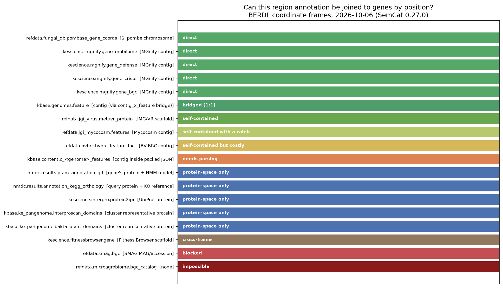
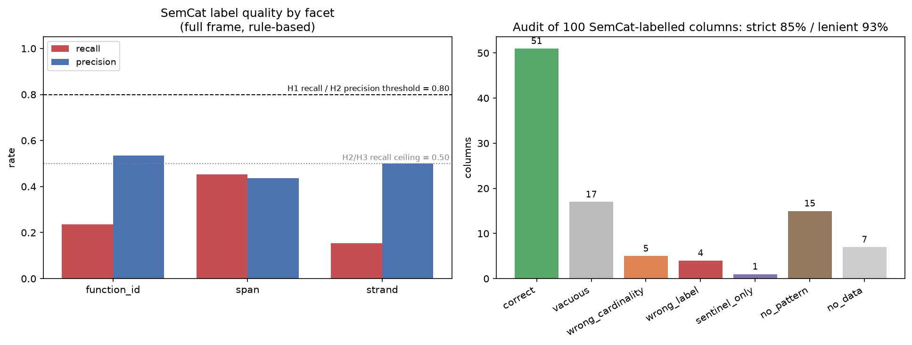

# Report: Gene and Protein Function Annotations in BERDL, with Coordinates

**Status:** reviewed · **Date:** 2026-10-07 · **Lakehouse snapshot:** 2026-10-07 ·
**SemCat snapshot:** catalog generated 2026-10-06T19:38:26Z, read at `code_version` 0.27.0

> SemCat's `code_version` advances without the catalog being regenerated — 0.24.2 → 0.26.1 →
> 0.27.0 were all observed against the same `generated_at` and the same 91,246 columns. The
> version above is the one this run read; the catalog *content* is pinned by `generated_at`.

> All four notebooks were re-executed in order against this single snapshot. An earlier
> draft mixed a 2026-10-02 run with a 2026-10-06 re-run of one notebook; see **Correction 3**.

A census of BERDL tables that assign function to genes and proteins or annotate regions of
genomes, genes and proteins; a test of whether their coordinates can actually be used for
collocation queries; and a graded assessment of SemCat as the instrument for finding them.

---

## Key Findings

### 1. Only 6 of 17 coordinate-bearing region tables can be joined to genes by position



This is the finding that governs everything else, and it is the one that would be missed by
reading schemas alone. "Has a start, an end, and a strand" and "can answer *which genes sit
near this region*" are different properties, and in BERDL they come apart badly.

Eighteen region-annotation tables were assessed for collocation. **Seventeen carry
coordinates** (16 with explicit span columns, 1 with coordinates packed inside a JSON string);
the eighteenth, `refdata.microagrobiome.bgc_catalog`, is included because it is a BGC table a
researcher would reach for, and carries no sequence coordinates at all. Of the assessed set:

| Collocation status | n | What it means |
|---|---:|---|
| **direct** | **5** | region and gene tables share a sequence namespace; interval join, no mapping step |
| **bridged (1:1)** | **1** | placeable through an exact 1:1 bridge table in the same database |
| self-contained (1), with a catch (1), but costly (1) | 3 | coordinates and function in one table; collocation is a self-join |
| needs parsing | 1 | coordinates exist but are packed inside a JSON string |
| **protein-space only** | **5** | coordinates are real but measured along a protein; they cannot reach a genome contig at all |
| cross-frame | 1 | two span columns in one database, in two different coordinate systems |
| **blocked** | **1** | coordinates present but impossible to place against genes |
| **no coordinates at all** | **1** | `refdata.microagrobiome.bgc_catalog` — the one non-coordinate-bearing table in this set |

**Positionally joinable: 6** — the 5 direct cases plus the 1 bridged case.

The five direct cases are `kescience.mgnify.gene_bgc`, `gene_crispr`, `gene_defense`,
`gene_mobilome` — all sharing `contig_id` with `kescience.mgnify.gene` — plus
`refdata.fungal_db.pombase_gene_coords` against its sibling CDS/exon tables.

The bridged case is **`kbase.genomes.feature`** (1,011,650,903 rows, the largest
coordinate-bearing feature table in the census). An earlier version of this report listed it as
*blocked*, on the grounds that the table carries `start`/`end`/`strand` but no sequence column.
That was wrong, and the error is instructive: `kbase.genomes.contig_x_feature` places every
feature on a contig with an **exact 1:1 mapping** — 1,011,650,903 rows, 1,011,650,903 distinct
`feature_id`, across 32,868,698 contigs — so one join yields `contig_id` + `start` + `end` +
`strand`, and a self-join on a single contig returns 14–15 CDS neighbours within ±5 kb. The
general lesson is that **joinability is a property of a table's database, not of its own column
list**; a bridge table has to be ruled out before coordinates are called unplaceable.

Two genuine negative cases remain, each of which looks usable until examined:

- **`refdata.smag.bgc`** has clean BGC intervals *and* BiG-SCAPE gene-cluster-family
  assignments that MGnify lacks — but SMAG ships no gene-coordinate table, so nothing can be
  placed against those intervals inside BERDL. (Re-checked for a bridge table after the
  `kbase.genomes` error: `refdata.smag` has no feature or gene table of any kind.)
- **`refdata.microagrobiome.bgc_catalog`** is a BGC table whose only coordinates are
  latitude and longitude.

*(Notebook: `04_bgc_region_joinability.ipynb`; data: `data/bgc_joinability.csv`)*

### 2. Both named queries work — in the MGnify frame

The discriminating query passed decisively: **28,494 of 28,494** distinct `gene_bgc` contig
identifiers (100%) match a `gene` contig identifier in the `soil` biome. Same namespace,
literally the same strings, no mapping table.

The interval join is run with a **±5,000 bp flank**, so that it answers *inside or near*,
which is what BGC-boundary work actually needs. Two different populations come out of it, and
they should not be conflated:

| Measure | Window | Value |
|---|---|---|
| gene–BGC pairs | inside **or within 5 kb** | **754,313** across 35,354 BGCs (21.3 per BGC) |
| genes strictly **inside** the BGC interval | inside only | **13.9 per BGC** |

The 13.9 figure is the real check, and it is the one to compare against biology: BGCs are
typically a handful to a few dozen genes, so a plausible inside-count indicates the join is
operating in a genuinely shared coordinate frame rather than matching strings by coincidence.
The 21.3 pairs-per-BGC figure is larger simply because the flank admits neighbouring genes by
design. Extending to a three-table join (BGC region → gene coordinates → eggNOG function) also
runs, so *which functions sit near a BGC* is answerable end to end.

Multi-domain search separates into two strengths of question, which BERDL supports unequally:

- **Co-occurrence** ("proteins with domains X and Y") — answerable from any per-protein
  domain list. 6,530 cluster representatives carry both PF00005 and PF00528.
- **Order and spacing** ("X then Y, N residues apart") — needs per-domain amino-acid
  coordinates. Counted **one protein, one vote** (a cluster votes for the order held by the
  majority of its domain pairs, since 395 proteins — 6% — carry repeat copies and would
  otherwise be counted several times): PF00528 precedes PF00005 in **6,167 of 6,530 proteins
  = 94.4%**. The undeduplicated pair-level figure is 6,578 of 6,963 = 94.5%, so the
  pseudo-replication is immaterial here — but it is reported both ways for the same reason
  NB03 quotes per-`schema_sig` rates. Either way the result is permease N-terminal, ATPase
  C-terminal: the expected fused ABC-transporter architecture. Inter-domain gap median
  −392 aa (IQR −412 to −371; the sign encodes the ordering).

That the architecture comes out right is a second, independent check that the amino-acid
coordinates mean what the census says they mean.

*(Notebook: `04_bgc_region_joinability.ipynb`; data: `data/example_genes_near_bgc.csv`,
`data/example_multidomain_hits.csv`)*

### 3. The census: 51 annotation tables, 24 with coordinates, in four coordinate systems

Full table in `data/annotation_sources.csv`; reproduced in **Results** below. 51 tables
survived adjudication: 20 both assign function *and* annotate a region, 22 assign function
without coordinates, 4 are region-only, 5 are reference vocabularies. A further **13
name-based false positives were excluded and recorded**, because what a naive rule gets wrong
is part of the answer.

Coordinate systems are not reducible to one axis: **15 nucleotide**, **5 amino-acid**, and
**4 tables carrying multiple frames in a single row**.

Three facts in this census were recoverable only by reading values, not schemas:

- **`nmdc.results.pfam_annotation_gff`** — at 2,684,369,000 rows the largest annotation table
  in BERDL — is named `_gff`, which implies genome coordinates. Its `start`/`end` are
  **amino-acid**: `end − start + 1 == alignment_length` exactly, on every row sampled. Its
  `model_start`/`model_end` are positions in the Pfam HMM, which is a third kind of coordinate
  and not a sequence position at all.
- **`kbase.content.c_<genome>_features`** packs `[["NZ_QSIR01000001.1", 1, "+", 855]]` —
  contig, start, strand, length — into a string column called `location`, and SEED Subsystem
  Ontology terms into `ontology_terms`. Full genomic coordinates plus ontology function
  assignment, and **not one column name says start, end, strand, contig, pfam, or go.**
- **`kbase.ke_pangenome.interproscan_domains`** carries **18 signature databases in one
  table**, selectable only via `DISTINCT analysis`: Pfam (145,825,639 rows), Gene3D,
  SUPERFAMILY, PANTHER, PRINTS, CDD, NCBIfam, ProSiteProfiles, MobiDBLite, SMART, FunFam,
  ProSitePatterns, Coils, Hamap, PIRSF, SFLD, AntiFam — plus a 1-row `Gene3` value that looks
  like a truncated `Gene3D`.

Two traps found in passing: `refdata.jgi_mycocosm.features` has `start` and `length_bp` but
**no `end`**; and `nmdc.metadata.genome_feature_set` has the best-modelled GFF3 schema in
BERDL (`seqid`/`start`/`end`/`strand`/`phase`/`feature_category_term_id`) and **0 rows**, in
both the canonical and the staging copy.

*(Notebook: `02_ground_truth_sweep.ipynb`; data: `data/annotation_sources.csv`,
`data/excluded_tables.csv`)*

### 4. SemCat is high-precision and low-recall (H2), on the subset tested



On the pre-registered 200-column audit, adjudicated against sampled **values** rather than
column names: **recall 32.3%**, **strict precision 85.0%** (51/60 judgeable), lenient 93.3% (56/60).
That is H2's pattern — the labels SemCat applies are mostly right; it just applies very few.

| Hypothesis | Criterion | Observed | Standing |
|---|---|---|---|
| H1 sufficient instrument | recall ≥0.80 on every facet **and** coordinate system resolvable | coordinate sub-test failed (5 systems share one label); recall 32.3% | **refuted** |
| H2 high precision, low recall | recall <0.50 **and** precision ≥0.80 | 32.3% and 85.0% (93.3% lenient) — holds under both adjudication policies and both units of analysis | **supported** |
| H3 structural not semantic | recall <0.50 **and** precision <0.80 **and** row_count ≥95% | precision 85.0% fails the <0.80 clause; other clauses hold | **refuted on its precision clause** |
| H0 no value over a name regex | refuted by ≥1 true positive the regex misses | 2 census tables; 128 `function_id` columns outside regex reach | **refuted** |

Where SemCat fails, concretely: `content_type` is NULL on **83.6%** of 91,246 columns (and
**91.9%** of the 66,054 in-frame columns); `concepts` contains **1 molecular label in 119** —
the rest are temperature, nitrate, depth, salinity, metals; `verified_joins` has **6 rows for
2,509 tables**, so the join layer is effectively unpopulated; and the single `coordinate`
label spans **five** coordinate systems, 32 of 78 (41%) of them geographic, with 22 columns
unresolvable even after bringing in type, numeric bounds and sibling column names.

Where it is reliable: `row_count` was **exact on 59 of 60** verifiable tables (98.3%; the one
miss, `refdata.jgi_virus.metavr_protein`, is off by 7 rows from growth since the snapshot),
and it indexes **493 candidate
annotation tables in tenants this account cannot read** — real value obtainable nowhere else.

Its table-level coverage is incomplete, though: within accessible tenants, **5 indexed tables
no longer exist** and **163 live tables are absent from SemCat** — including all 25 of
SemCat's own tables and `globalusers.kepangenome_parquet_1`, which holds a 1,011,650,903-row
gene-coordinate table. Table-level agreement: **80.3%**.

*(Notebooks: `01_semcat_discovery.ipynb`, `03_semcat_grade.ipynb`; data: `data/semcat_grade.csv`,
`data/audit_precision.csv`, `data/audit_recall.csv`, `data/semcat_confusion_by_facet.csv`)*

---

## Scope of the SemCat verdict — what was and was not tested

**This evaluated 5 of SemCat's 25 tables.** The verdict in Finding 4 applies to that subset
and to nothing else.

**Exercised:** `catalog_meta`, `tables` (including `row_count` and `schema_sig`), `columns` (including
`content_type`, `role`, `facet_layer`, `facet_confidence`, bounds), `concepts`, and
`verified_joins` (row count only — with 6 rows there was nothing to evaluate).

**Not exercised — 20 tables:** `column_embeddings`, `edges`, `database_edges`, `derivations`,
`l4_curation`, `ontology_hierarchy`, `catalog_detectors`, `databases`, `tenants`,
`compound_columns`, `compound_dict`, `compound_membership`, `compound_xref`, `taxon_columns`,
`taxon_dict`, `taxon_membership`, `taxon_synonym`, `eav_attributes`, `eav_membership`,
`quantity_members`.

**No SemCat CLI was used.** There is no `semcat` executable on this machine's `PATH`, so
neither `semcat resolve` nor `semcat joins` was exercised. If those commands exist in another
environment, they may implement retrieval strategies — embedding similarity over
`column_embeddings`, graph traversal over `edges` — that perform materially better than the
raw `content_type` lookup measured here.

This matters for how the verdict should be read. `column_embeddings` (128 columns' worth of
vectors) and the 15,490-row `edges` table are precisely the components one would expect to
compensate for sparse `content_type`: a semantic-similarity search might retrieve relevant
columns that carry no label at all, which is the exact failure mode behind the 32% recall. **A
fair statement is therefore: SemCat's *literal label lookup* is high-precision and
low-recall. Whether SemCat *as a system* is low-recall is untested.** Finding 4 should not be
cited as a verdict on the whole catalog.

---

> **A note on the claims ledger.** `beril claims build` flags **1 of 6** claims as `single-stream` with a confidence mismatch: the `pfam_annotation_gff` coordinate-system claim. The flag is correct and is left standing rather than argued away. The claim rests on one measurement by its nature — an exact arithmetic identity (`end − start + 1 == alignment_length`) that held on all N = 26,779 rows of a seeded random sample (NB02 §9) — which is not a statistical estimate a second method would independently corroborate, but has not been cross-checked by one either. The `coordinate`-label conflation claim, flagged in earlier builds, now carries a second stream: NB02 §10 checks SemCat-metadata typing against the live-data census and finds 0 contradictions across 36 overlapping columns.

## Claims

### Only 6 of 17 coordinate-bearing BERDL region-annotation tables can be joined to gene coordinates by position (5 directly, 1 through a 1:1 bridge)
- confidence: high
- status: supported
- supports:
  - notebook: notebooks/04_bgc_region_joinability.ipynb#cell-21 [stream: joinability-frame-test] — "collocation_direct: 5, collocation_bridged: 1, collocation_positionally_joinable: 6, collocation_protein_only: 5"
  - notebook: notebooks/02_ground_truth_sweep.ipynb#cell-28 [stream: schema-census] — "census: 51 tables, 24 coordinate-bearing (15 nucleotide, 5 amino-acid, 4 multiple frames)"

### BGC regions and gene coordinates in kescience.mgnify share a contig namespace exactly, making "genes near a BGC" a single interval join
- confidence: high
- status: supported
- supports:
  - notebook: notebooks/04_bgc_region_joinability.ipynb#cell-5 [stream: identifier-overlap] — "shared_contigs 28,494 / 28,494 bgc_contigs = 100%"
  - notebook: notebooks/04_bgc_region_joinability.ipynb#cell-12 [stream: biological-plausibility] — "gene_bgc_pairs 754313, bgcs_with_genes 35354, genes_per_bgc 21.3, genes_inside_per_bgc 13.9"

### nmdc.results.pfam_annotation_gff uses amino-acid coordinates despite its _gff name, and additionally carries HMM-model coordinates in the same row
- confidence: high
<!-- Single evidence stream by nature: an exact arithmetic identity tested on a seeded random
     sample (N = 26,779 rows, 0 mismatches; data/pfam_coordinate_check.json), not a statistical
     inference. No second independent method was applied, and the claims ledger flags it as
     single-stream. -->
- status: supported
- supports:
  - notebook: notebooks/02_ground_truth_sweep.ipynb#cell-30 — "N tested: 26,779; end-start+1 != alignment_length: 0; max(end) in sample: 3,625; max(model_end): 1,530"

### SemCat's content_type label lookup is high-precision and low-recall: it labels a minority of relevant columns but is mostly correct when it does
- confidence: medium
- status: supported
- supports:
  - notebook: notebooks/03_semcat_grade.ipynb#cell-11 [stream: value-adjudicated-precision] — "strict precision 51/60 = 85.0%, lenient 56/60 = 93.3%"
  - notebook: notebooks/03_semcat_grade.ipynb#cell-18 [stream: label-family-recall] — "recall 30/93 schema_sig groups = 32.3%; 30/100 = 30.0% per column"
  - notebook: notebooks/01_semcat_discovery.ipynb#cell-13 [stream: catalog-completeness] — "content_type NULL on 83.6% of 91,246 columns"
- refutes:
  - docs: scope — "20 of 25 SemCat tables untested, including column_embeddings and edges; no semcat CLI exercised. A retrieval path over embeddings could raise recall substantially, so this claim covers literal label lookup only."

### SemCat's content_type='coordinate' conflates geographic, nucleotide, amino-acid and HMM-model coordinates under one label
- confidence: high
- status: supported
- supports:
  - notebook: notebooks/01_semcat_discovery.ipynb#cell-7 [stream: semcat-metadata-typing] — "78 labelled columns: geographic: 32   molecular (nt/aa/model): 24   ambiguous: 22"
  - notebook: notebooks/02_ground_truth_sweep.ipynb#cell-32 [stream: live-census-crosscheck] — "SemCat 'coordinate' columns: 78; in census tables: 36; contradictions: 0; census-confirmed systems under the one label: amino_acid, hmm_model, nucleotide"

### SemCat's tables.row_count is accurate where verifiable, while its table-level coverage is 80.3% against the live catalog
- confidence: high
- status: supported
- supports:
  - notebook: notebooks/02_ground_truth_sweep.ipynb#cell-23 [stream: coverage-diff] — "in SemCat but GONE live (stale) : 5; live but MISSING from SemCat : 163; agreement : 663/826 = 80%"
  - notebook: notebooks/02_ground_truth_sweep.ipynb#cell-27 [stream: rowcount-verification] — "59 of 60 verifiable row counts exact (98.3%), computed live in-cell; H3 >=95% clause MET"

---

## Discoveries

- A table's name can misstate its coordinate system at scale: `nmdc.results.pfam_annotation_gff`
  (2.68B rows) is named `_gff` but stores amino-acid coordinates — confirmed by
  `end − start + 1 == alignment_length` — plus HMM-model coordinates in the same row.
- "Has coordinates" and "can be joined to genes by position" are distinct table properties. In
  BERDL only 6 of 17 coordinate-bearing region tables satisfy the second — and one of those six
  was initially misjudged as unusable because its bridge table was not looked for.
- `kbase.ke_pangenome.interproscan_domains` carries 18 signature databases in one table,
  discoverable only from `DISTINCT analysis` — no column name enumerates them.
- Coordinates can hide inside a string: `kbase.content.c_<genome>_features.location` holds
  `[[contig, start, strand, length]]` as JSON, with SEED ontology terms in `ontology_terms`.
  No column name discloses either, so both semantic catalogs and name-based regexes miss it.
- Pangenome domain tables (`interproscan_domains`, `bakta_pfam_domains`) key on *cluster
  representatives*, not genome genes, so their protein coordinates cannot reach a contig
  without a cluster-member mapping.
- `nmdc.metadata.genome_feature_set` has the most complete GFF3 schema in BERDL and 0 rows —
  a schema promising data that does not exist.
- Automated catalog labels can be right about vocabulary and wrong about cardinality:
  `bakta_annotations.go` holds `GO:0000287;GO:0008927;…`, so `WHERE go = 'GO:0006064'`
  silently matches nothing despite a correct `go_term` label.

## Performance Notes

- Live `DESCRIBE` across the whole accessible catalog is cheap: 826 tables / 67,587 columns in
  ~110 s (0.13 s/table). Building an independent schema ground truth is affordable; there is
  no need to trust a catalog's column list for this purpose.
- Iceberg `COUNT(*)` is metadata-served and returns in seconds even at 2.68B rows — 60 tables
  counted in under 30 s. Compute row counts in the notebook that reports them; caching them to
  a file is how a chain goes stale (see Correction 5).
- Value sampling for label adjudication should use `SELECT col ... WHERE col IS NOT NULL LIMIT
  n` (limit pushdown, no shuffle). Avoid `DISTINCT`, which forces a shuffle on billion-row
  tables.
- A 12-value sample is too small for format adjudication: placeholder-heavy columns (`-`,
  `nan`, `None`) return all-sentinel samples and produce false "mislabelled" verdicts. 60
  values reduced sentinel-only outcomes from 7 to 1.
- `kescience.mgnify.gene_bgc` and friends are partitioned by `biome_id`; filter on it. The
  whole of `gene_bgc` (35,354 rows) is the `soil` biome.

---

## Results

### Coordinate-bearing tables (24)

| Table | Region type | Coord system | Frame | Span | Strand | Identifier systems | Rows |
|---|---|---|---|---|---|---|---|
| `kbase.ke_pangenome.interproscan_domains` | protein domain/motif | amino_acid | pangenome cluster-representative protein | start..stop | — | InterPro, Pfam, Gene3D, SUPERFAMILY, PANTHER, PRINTS, CDD, NCBIfam, +10 more | 833,303,130 |
| `kbase.ke_pangenome.bakta_pfam_domains` | protein domain | amino_acid | pangenome cluster-representative protein | start..stop | — | Pfam | 18,807,208 |
| `kescience.interpro.protein2ipr` | protein domain/motif | amino_acid | UniProt protein | start..stop | — | InterPro, Pfam, member-DB signatures | 1,175,529,272 |
| `kescience.fitnessbrowser.genedomain` | protein domain | amino_acid | Fitness Browser protein (orgId+locusId) | begin..end | — | Pfam, TIGRFAM, EC (per-row via `domainDb`) | 456,712 |
| `kescience.paperblast.site` | functional residue/site | amino_acid | protein sequence (db+id) | posFrom..posTo | — | PDB, UniProt, ligand IDs, PMIDs | 2,089,192 |
| `nmdc.results.pfam_annotation_gff` | protein domain | **multiple** | gene's protein + Pfam HMM | start..end | — | Pfam | 2,684,369,000 |
| `nmdc.results.annotation_kegg_orthology` | alignment segment | **multiple** | query protein + KO reference protein | q_start..q_end | — | KEGG KO | 1,831,998,811 |
| `nmdc.results.annotation_enzyme_commission` | alignment segment | **multiple** | query protein + EC reference protein | q_start..q_end | — | EC | 1,231,453,377 |
| `kescience.pdb.pdb_uniprot_mapping` | structural segment | **multiple** | PDB author numbering + SEQRES + UniProt | res/sp/pdb beg..end | — | PDB, UniProt | 966,977 |
| `refdata.bvbrc.bvbrc_feature_fact` | gene/CDS | nucleotide | BV-BRC contig (within genome_id) | start_pos..end_pos | strand | EC, KEGG KO, protein families (all JSON-packed) | 1,895,015,043 |
| `kbase.genomes.feature` | gene/CDS | nucleotide | contig, via the 1:1 `contig_x_feature` bridge | start..end | strand | type, source_database; free-text RAST function via `feature_x_protein`→`protein`→`functional_annotation_rast` (schema-confirmed, join not executed) | 1,011,650,903 |
| `refdata.jgi_virus.metavr_protein` | gene/CDS (viral) | nucleotide | IMG/VR scaffold | start..end | strand | Pfam (array-typed), protein_cluster, product | 369,281,941 |
| `kescience.mgnify.gene` | gene/CDS | nucleotide | MGnify contig | start..end | strand | via `gene_eggnog` / `gene_amr` / `gene_bgc` | 142,872,191 |
| `kbase.nmdc_arkin.metatranscriptomics_gold` | expressed feature | nucleotide | contig/scaffold | — | strand | expression values | 75,119,498 |
| `refdata.jgi_mycocosm.features` | gene/CDS/mRNA (fungal) | nucleotide | Mycocosm contig | start + **length_bp (no `end`)** | strand | free-text functions | 17,945,606 |
| `globalusers.carbon_source_phenotypes.gene_calls_table` | gene call | nucleotide | contig | start..end | strand | KO via `kofam_annotation_table` | 5,111,055 |
| `kescience.fitnessbrowser.gene` | gene/CDS | nucleotide | Fitness Browser scaffold | begin..end (string) | strand | via `besthitkegg` / `seedannotation` | 228,709 |
| `refdata.smag.bgc` | **BGC** | nucleotide | SMAG MAG contig (accession_id) | start..end | — | antiSMASH, BiG-SCAPE class/family | 43,169 |
| `kescience.mgnify.gene_crispr` | CRISPR array | nucleotide | MGnify contig | crispr_start..crispr_end | `orientation` | repeat/spacer properties | 42,437 |
| `kescience.mgnify.gene_bgc` | **BGC** | nucleotide | MGnify contig | start_pos..end_pos | — | antiSMASH, MIBiG | 35,354 |
| `kescience.mgnify.gene_mobilome` | mobile element | nucleotide | MGnify contig | start_pos..end_pos | — | element typing | 171,662 |
| `kescience.mgnify.gene_defense` | defense system | nucleotide | MGnify contig | system_start..system_end | — | defense typing | 27,858 |
| `refdata.fungal_db.pombase_gene_coords` | gene | nucleotide | *S. pombe* chromosome | start..end | strand | PomBase IDs | 12,685 |
| `kbase.content.c_<genome>_features` | gene/CDS | nucleotide | **packed JSON** | `location[[contig,start,strand,len]]` | in JSON | SEED SSO ontology, free-text function | 3,734/genome |

### Function assignment without coordinates (22)

| Table | # ID systems | Identifier systems | Keyed on | Rows |
|---|---:|---|---|---|
| `kbase.ke_pangenome.eggnog_mapper_annotations` | 9 | eggNOG OGs, COG cat, GO, EC, KEGG ko/Pathway/Module/Reaction/rclass/TC, BRITE, CAZy, BiGG, Pfam | `query_name` | 93,558,330 |
| `kbase.ke_pangenome.bakta_annotations` | 9 | EC, GO, COG, COG cat, KEGG KO, RefSeq, UniParc, UniRef100/90/50 | `gene_cluster_id` | 132,538,155 |
| `kescience.mgnify.gene_eggnog` | 7 | eggNOG OGs, COG cat, GO, EC, KEGG, CAZy, Pfam | `gene_id` | 144,775,367 |
| `kbase.ke_pangenome.interproscan_pathways` | 4 | KEGG, MetaCyc, Reactome, UniPathway | `gene_cluster_id` | 287,228,475 |
| `kescience.pdb.pdb_pfam` | 3 | Pfam, UniProt, PDB | `pdb_id + chain_id` | 990,166 |
| `globalusers.gapmind_pathways.gapmind_pathways` | 2 | GapMind pathway, metabolic_category | `genome_id` *(genome-level)* | 463,729,001 |
| `kbase.nmdc_arkin.proteomics_gold` | 2 | KO, EC | protein identifiers | 345,877 |
| `refdata.merops.uniprot_family_map` | 2 | MEROPS family, UniProt | uniprot accession | 116,733 |
| `refdata.microagrobiome.bgc_catalog` | 2 | BGC identifiers, host/plant metadata | `bgc / anchor / bin` | 139,900 |
| `kbase.ke_pangenome.bakta_amr` | 2 | AMR gene names, reference accession | `gene_cluster_id` | 83,008 |
| `kbase.ke_pangenome.interproscan_go` | 1 | GO | `gene_cluster_id` | 266,317,724 |
| `kbase.ke_pangenome.gapmind_pathways` | 1 | GapMind pathway/step | `gene_cluster_id` | 305,471,280 |
| `refdata.bvbrc.bvbrc_specialty_gene_fact` | 1 | specialty gene family (AMR, virulence, drug target) | `feature_id` | 162,781,795 |
| `refdata.cazy.annotations` | 1 | CAZy family | `protein_accession` | 6,006,576 |
| `globalusers.carbon_source_phenotypes.kofam_annotation_table` | 1 | KEGG KO | `geneid` | 5,235,819 |
| `kescience.fitnessbrowser.besthitkegg` | 1 | KEGG | `orgId + locusId` | 200,074 |
| `kescience.fitnessbrowser.seedannotation` | 1 | SEED subsystem/role | `orgId + locusId` | 177,519 |
| `refdata.fungal_db.sgd_go_annotations` | 1 | GO | SGD gene ID | 138,996 |
| `kescience.fitnessbrowser.besthitmetacyc` | 1 | MetaCyc | `orgId + locusId` | 59,723 |
| `refdata.tcdb.acc_to_tcid` | 1 | TCDB TC number | accession | 24,691 |
| `kescience.mgnify.gene_amr` | 1 | AMRFinder typing | `gene_id` | 8,862 |
| `refdata.smag.cas_proteins` | 1 | Cas protein typing | protein/MAG ids | 8,545 |

### Reference vocabularies (5)

`refdata.interpro.entry_xref` (626,311,209) · `refdata.rhea.rhea2uniprot` (397,133) ·
`kescience.interpro.entry` (51,489) · `refdata.interpro.interpro2go` (30,122) ·
`nmdc.ref_data.pfam_terms` (27,481)

### Excluded after inspection (13)

Recorded in `data/excluded_tables.csv`. Notable: `kbase.nmdc_arkin.metabolomics_gold` and
`lipidomics_gold` (mass-spec scan numbers, not genomic spans);
`nmdc.metadata.material_processing_set` (whose `is_stranded` and `stranded_orientation` are
RNA-seq *library* strandedness — and are two of the six columns SemCat labels `strand`);
`refdata.spire.mag_coordinates` (named "coordinates", entirely geographic);
`nmdc.metadata.genome_feature_set` (complete GFF3 schema, 0 rows).

---

## Interpretation

The practical conclusion is that **coordinate system, not coordinate presence, is the thing to
check first** when planning region-aware work in BERDL. The catalog contains over 8 billion
rows of coordinate-bearing annotation, but those coordinates live in at least four
incommensurable frames — nucleotide positions on a contig, amino-acid positions on a protein,
residue numbering in a solved structure, and positions within an HMM profile — and two tables
in the same database can disagree. `kescience.fitnessbrowser` is the cleanest illustration:
`gene.begin/end` are nucleotide positions on a scaffold while `genedomain.begin/end` are
amino-acid positions on the protein. The tables join cleanly on `(orgId, locusId)` and must
never be joined on position.

For BGC work specifically, the usable path is narrow but real. `kescience.mgnify` is the only
place where a BGC region, a gene table, and functional annotation all share one frame and one
key, and the demonstration confirms it end to end. The cost is coverage: 35,354 BGCs, all in
the soil biome. `refdata.smag.bgc` has richer BGC semantics (BiG-SCAPE families, which support
cluster-family questions MGnify cannot answer) and is unusable for collocation because SMAG
ships no gene table. That is a tractable gap — it needs one table, not new science.

For multi-domain search, the pangenome domain tables are excellent *within protein space* and
structurally unable to leave it. `interproscan_domains` supports exactly the ordered,
spacing-aware queries that a tool like cblaster performs, and its 18 bundled signature
databases make it the single richest functional resource in the lakehouse. But it keys on
cluster representatives, so "find this domain architecture, then tell me what is next to it on
the chromosome" requires a cluster-member-to-genome mapping that this analysis did not locate.

On SemCat: the honest summary is that it is better than its headline numbers suggest and worse
than its interface implies. When it labels a column it is usually right (84–92%), including
columns a name-based search would never find — 128 `function_id`-labelled columns fall outside
the reach of this project's own regex. That is genuine, non-trivial value, and it is why H0 is
refuted. But 83.6% of columns carry no label, one concept in 119 is molecular, the join layer
has six rows, and the one label that speaks to this project's central question —
`coordinate` — is ambiguous across five meanings. A user who treats `content_type` as a filter
will get a clean, confident, badly incomplete answer, which is the worst failure mode a
discovery tool can have. The right workflow is SemCat-as-seed then expand, never
SemCat-as-bound. **With the large caveat in "Scope of the SemCat verdict" above: the
embedding and graph layers that might fix precisely this were not tested.**

### Literature Context

- The discovery/exploration split in **Paton, Chen & Wu (2023,** *ACM Computing Surveys*,
  doi:10.1145/3626521**)** maps directly onto what was measured. SemCat performs adequately at
  *discovery* (finding candidate tables, especially outside a user's grants) and poorly at
  *exploration* (understanding what a column means, and how tables relate — its
  `verified_joins` layer is empty). Their framing anticipates that these fail independently;
  this is an instance.
- **Bianchini et al. (2023,** *Knowl. Inf. Syst.*, doi:10.1007/s10115-023-02014-1**)** describe
  PERSEUS, a semantic metadata catalog over a data lake with the same design posture, and
  treat annotation coverage as a known weak link. The 84% NULL rate found here is therefore
  consistent with a general property of this architecture rather than a BERDL-specific defect
  — a point in SemCat's favour, not against it.
- **Gilchrist et al. (2021,** cblaster, *Bioinformatics Advances*,
  doi:10.1093/bioadv/vbab016**)** states the functional requirement this census was scored
  against: collocation search needs, per gene, a sequence identifier and a position in a shared
  frame. The joinability result is essentially a report of how many BERDL tables meet
  cblaster’s precondition — 6 of 17 coordinate-bearing tables.
- **Jørgensen et al. (2024,** *NAR*, doi:10.1093/nar/gkae523**)** show that positional
  information carries biology in BGC work (core genes central, specialized-metabolite BGCs
  distal on the *Streptomyces* chromosome). This supports treating coordinate-free BGC tables
  such as `refdata.microagrobiome.bgc_catalog` as categorically less useful, not merely less
  convenient.
- **van der Hooft et al. (2020,** *Chem. Soc. Rev.*, doi:10.1039/d0cs00162g**)** supply the
  MIBiG/BiG-SCAPE context that `kescience.mgnify.gene_bgc` (`nearest_mibig`) and
  `refdata.smag.bgc` (`big_scape_class`, `gcf_class`) are expressed in, confirming the two
  tables answer complementary questions.

Prior BERIL work was checked through the knowledge layer. The nearest items —
`gene_function_ecological_agora`'s `Final_Data_Catalog/Sources.md` and
`plant_microbiome_ecotypes`' data manifest — are hand-compiled, project-scoped source lists.
They overlap this census on the pangenome and MGnify tables but record neither coordinate
system nor joinability. That several projects independently rebuilt partial versions of this
list is itself evidence the census was needed.

### Novel Contribution

Against `references.md` and the knowledge layer, two things appear not to have been recorded
before — stated as claims about those two sources, which is all that was checked:

1. **A coordinate-frame map of BERDL annotation tables.** Prior catalogues list tables and
   purposes; none distinguishes nucleotide from amino-acid from HMM-model coordinates, nor
   identifies which pairs are positionally joinable. The `_gff`-named table holding amino-acid
   coordinates and the billion-row feature table with no sequence column are both the kind of
   error this map exists to prevent.
2. **A measured baseline for BERDL's semantic catalog.** No prior precision/recall assessment
   of SemCat was found. The value-adjudicated protocol here (sample values, validate against
   the format the label claims, separate cardinality errors from vocabulary errors) is
   reusable for tracking whether catalog quality improves.

### Scope of the Claim

**The census is complete for 8 of 21 tenants and metadata-only for the other 13.** This
account can read 826 tables across 104 databases; SemCat indexes 2,509 tables across 22
tenants. Everything verified here — coordinate systems, identifier systems, row counts,
joinability — covers that **34%** slice. The 13 unreadable tenants include SemCat's largest
(`enigma`) and contain 493 candidate annotation tables that could not be opened,
among them the only operon-region tables found anywhere
(`enigma.genome_depot_enigma.browser_operon`) and the only polysaccharide-utilization-locus
table (`arkinlab.dbcan.dbcan_pul`). Read access was confirmed denied, not merely untested.

What does not follow: this is **not** a census of BERDL. It is a census of the part of BERDL
one account could open on 2026-10-02, and the region-annotation picture in particular is
likely to be *understated*, because the inaccessible genome-browser tenants (`enigma`,
`phagefoundry`, `protect`) carry `browser_gene`/`browser_operon`/`browser_site` families that
are exactly the shape this project found scarce.

The SemCat grade inherits the same boundary. Precision and recall were computed over the 636
tables that are both live and indexed, in readable tenants only. Label quality in `enigma` or
`phagefoundry` could differ systematically and was not sampled. And per the scope section
above, the grade covers 5 of 25 SemCat tables and no CLI retrieval path.

The BGC demonstration is narrower still: one biome (`soil`), because all 35,354 rows of
`gene_bgc` are soil. The 13.9-genes-per-BGC figure is a property of that cohort.

### Limitations

- **Ground truth was built by regex plus manual adjudication, and the regex is demonstrably
  incomplete.** `kbase.content.c_<genome>_features` — which has contig, start, strand and
  ontology terms — was missed by the name-based sweep and found only by reading the values of
  a column called `location`. Others of this kind almost certainly remain. Recall figures for
  SemCat are therefore computed against a ground truth that is itself a lower bound, which
  means true recall may be *lower* than 32%, not higher.
- **The full-frame confusion matrix (`data/semcat_confusion_by_facet.csv`) is biased against
  SemCat** and should not be quoted as a precision estimate. It treats this project's regex as
  truth, so SemCat is charged a false positive whenever it labels a column the regex failed to
  recognise — which is SemCat succeeding. The value-adjudicated audit supersedes it.
- **Precision rests on 60 judgeable columns.** Confidence intervals were not computed; a
  binomial CI on 51/60 is roughly ±9 points, whose lower bound sits near the 0.80 decision
  threshold. The H2 verdict should be read as "consistent with high precision", not
  "precision is 85.0%".
- The `strand` facet is too small for a stable per-facet rate — 17 genomic-strand columns
  across all accessible tables, 13 of them inside the audited frame, against 4 SemCat labels —
  though it is the worst performer on every measure.
- Pseudo-replication was handled explicitly in the two places it could bite: per-`schema_sig`
  for the SemCat audit (cloned staging tables) and per-protein for the domain-order statistic
  (repeat domain copies). Both corrections were immaterial — they moved recall 30.0% → 32.3%
  and domain order 94.5% → 94.4% — but neither was checked until review prompted it.
- **The audit's value sample was not bit-reproducible for most of this project's life, and one
  reported figure moved because of it.** `03` originally drew values with `LIMIT 60` and no
  `ORDER BY`, which Spark/Iceberg do not guarantee to return in a stable order. Across five
  full-chain re-runs one column migrated between `wrong_cardinality` and `wrong_label`, moving
  lenient precision between 93.2% and 94.9%; an earlier draft quoted 94.9% while the artifacts
  said 93.2% (`REVIEW_7.md` caught it). **Fixed in Correction 7** — the sampler is now
  deterministic and the audit reproduces exactly. The figures in this report are from the first
  run under the fixed sampler. What remains outside the project's control is the live catalog,
  which is pinned by snapshot rather than frozen.
- Coordinate systems were determined per table, not per row. A table could in principle mix
  conventions across rows; this was not tested.
- The sweep completed with **0 failures** on the final snapshot. An earlier run hit 13
  failures from one cause (a stale `s3a://cdm-lake/users-sql` location under `mamillerpa`/`my`,
  personal scratch databases); those tables had been removed by 2026-10-06.
- `verified_joins` was assessed by row count (6) only. Its six entries were not checked for
  correctness.
- Prior-art claims rest on `references.md` (OpenAlex-derived; PubMed and Semantic Scholar
  returned nothing for these queries in this session) and the knowledge layer. This is not an
  exhaustive literature review.

### What Would Have Changed Our Mind

- **The pre-registered refutation of the main use-case finding** was an empty contig-id
  intersection between `gene_bgc` and `gene`. Had that returned zero, the coordinates would
  have been unusable for collocation regardless of completeness, and Finding 2 would have been
  a negative result. Observed: **28,494/28,494 shared, 100%** — the strongest possible pass.
  The 13.9-genes-per-BGC figure is the secondary check; an implausible value (0.2, or 400)
  would have indicated a spurious string match even with full id overlap.
- **H1 had two independent refutation routes and failed both.** The coordinate sub-test (if
  SemCat could sort its `coordinate` columns into systems, H1 survived — it could not,
  5 systems share the label) and the ≥0.80 recall bar (observed 32%).
- **Looked for and not found:** a cluster-member-to-genome mapping that would let the pangenome
  domain tables (`interproscan_domains`, 833M rows) reach a contig. None was located in the
  readable catalog. This is the single biggest limit on the lakehouse's domain data and the
  main reason 5 tables are stranded in protein space.
- **Evidence against the headline SemCat verdict, stated here rather than left in a notebook:**
  the full-frame rule-based figures (function_id precision 0.53, span 0.44, strand 0.50) are
  much harsher than the audit's 85.0% and would support H3. They are reported as biased for
  the reason given under Limitations, but a reader who rejects that argument should read the
  precision verdict as unresolved between H2 and H3.
- **A result that argues against the census being complete:** `kbase.content.c_<genome>_features`
  proves at least one whole class of annotation table is invisible to name-based discovery.
  The census should be read as a floor on BERDL's annotation holdings, not a ceiling.
- **Prior movement.** The plan put H3 at MEDIUM-HIGH and H2 at LOW-MEDIUM. The evidence moved
  the posterior the other way: H2 supported, H3 refuted on precision. The H3 *bookkeeping*
  claims (row_count exact, coverage beyond own inventory) were confirmed, so the prior was
  right about SemCat's structural value and wrong about its label quality.

### Eight corrections made during analysis

All are kept visible because each changed a reported number, and in one case a verdict. Two
were self-detected (1, 2); **four were found by independent review** (3, 4, 5, 6); the seventh
closes the root cause the sixth only diagnosed; **the eighth was found by a human reader who
knew a prior project had already done the join I said was impossible** (8).
Corrections 3 and 5 are the same defect — a cached value silently carrying an old snapshot —
which survived its own first fix. That it recurred is the more useful finding than either
instance.

**1. Precision, and the H3 → H2 flip.** The first pass of the audit sampled 12 values per
column and scored each label simply correct-or-wrong, giving strict precision **77.8%** and
therefore "H3 supported". Two defects: a 12-value sample frequently returned only placeholders
(`-`, `nan`, `None`), which was scored against SemCat though it is a limitation of the
*sample*; and multi-valued columns (`go` holding `GO:0000287;GO:0008927`) were scored
identically to genuinely mislabelled ones. Re-run with 60 values and a four-way adjudication
(`correct` / `wrong_cardinality` / `wrong_label` / `sentinel_only`, the last excluded):
strict precision **83.9%** (on the 2026-10-02 snapshot; **86.4%** on the 2026-10-06 re-run;
**85.0%** once sampling was made deterministic — Correction 7), verdict **H2**. Recall was ~32% under both passes and both snapshots, so H1's
refutation never depended on this. Logged as a minor deviation in `RESEARCH_PLAN.md` Revision
History v2 — no threshold, hypothesis or discrimination strategy changed, and the plan's own
`plan_digest` confirms the approval remains valid. The revision nonetheless followed seeing a
result and moved a verdict; the strict/lenient pair is a post-hoc choice that is non-decisive
only because H2 holds under both figures.

**2. Inter-domain gap.** First reported as median **−680.5 aa** from a 300-row sample taken
*after* `ORDER BY gap_aa` — the extreme tail, not the distribution. Recomputed with
`percentile_approx` over the full 6,963-row join: median **−392 aa**, IQR −412 to −371.

**3. Mixed snapshots, caught by independent review.** While adding the `row_count`
verification cell (itself a fix for a missing-provenance problem), `02_ground_truth_sweep.ipynb`
was re-executed on 2026-10-06 while notebooks 01, 03 and 04 still held their 2026-10-02 run.
Because 01 and 02 read live catalog state top-to-bottom, this silently desynchronised the
report from the repository: `REPORT.md` quoted 883 accessible tables, 69,601 columns, 13 sweep
failures and 159 stale / 185 missing, while the notebooks as saved produced 826 / 67,575 / 0
and 5 / 163. `03_semcat_grade.ipynb`'s saved outputs were also stale against the
`ground_truth_columns.csv` it reads. `REVIEW_1.md` found this by cross-checking file
timestamps and cell outputs against the prose; it was not self-detected.

Fixed by re-executing **all four notebooks in order** against a single 2026-10-06 snapshot and
restating every affected figure. Two things emerged while doing so:

- **SemCat is a fast-moving target.** Its `code_version` went 0.19.28 (2026-09-29) → 0.21.6
  (2026-10-06 04:12) → 0.24.2 (2026-10-06 19:38) → 0.26.1 → 0.27.0 (code bumps seen 2026-10-07, catalog
  content unchanged) — four version stamps inside nine days, two
  of them within one working day. Indexed tables moved 2,599 → 2,509 and columns 93,617 →
  91,246. Any measurement of this catalog is a measurement of one version of it, which is why
  the header now pins the exact snapshot.
- **Most of the apparent "staleness" improvement was SemCat catching up**, not the lakehouse
  changing: the three dated NMDC staging databases that produced 159 stale tables on 10-02 had
  been dropped from SemCat's index by 10-06, taking the figure to 5.

The qualitative conclusions are unchanged across both snapshots — H1 and H0 refuted, H2
supported, 5 of 17 coordinate-bearing tables directly joinable, the census stable at 51 entries. The numbers moved;
the findings did not.

**4. A pre-registered correction that had not been implemented.** `RESEARCH_PLAN.md` committed
to computing every rate twice, per column and per distinct `schema_sig`, so that cloned staging
tables could not inflate *n*. The first pass simply did not do this; `REVIEW_1.md` caught it.
Now implemented in `03_semcat_grade.ipynb` §2b-bis. The precision sample contained no clones
(59 columns → 59 groups), so precision is unaffected. The recall sample collapsed 100 columns
into 93 groups, moving recall from 30.0% per column to **32.3%** per `schema_sig`. Per the
plan, the `schema_sig` figure is the one quoted. The correction slightly *helps* SemCat, and
does not change any verdict.

**5. The same staleness bug, one layer deeper — found by `REVIEW_2.md`.** After fixing
Correction 3, the §6a row-count cell still *said* it checked "against live Iceberg
`COUNT(*)`" while its code read `data/row_counts_verified.json` — a file dated 2026-10-02
that no cell or script regenerated. It fed the census's `row_count` column, the H3 ≥95%
clause and a Performance Note, none of which the repository could actually reproduce. This is
the identical failure mode `REVIEW_1.md` had already caught once, surviving in a place the
first fix did not reach, and it was not self-detected either.

§6a now issues the `COUNT(*)` queries itself and re-emits `annotation_sources.csv`,
`row_counts_verified.json/csv` and `row_count_grade.csv` from that live result, so the number
and the file cannot diverge. Measured live: **59 of 60 exact (98.3%)** — the target set is now
exactly the census tables, hence 60 rather than the earlier 66. The H3 clause still passes with
margin. The general lesson is recorded in `memories/pitfalls.md`: **compute a figure in the
notebook that reports it; a cached intermediate is a snapshot waiting to desynchronise.**

**6. Lenient precision was wrong in three places — found by `REVIEW_7.md`.** `REPORT.md`,
`SCOREBOARD.md` and `claims.json` all stated lenient precision as **56/59 = 94.9%** while every
artifact — the notebook's printed output, `data/audit_precision.csv`,
`data/nb03_summary.json` and the figure's own title — said **55/59 = 93.2%**. The 94.9% was
true of an earlier run in which the verdict split was `wrong_cardinality=5, wrong_label=3`;
the current run splits 4/4. Corrected everywhere.

The cause matters more than the number. The audit samples values with `LIMIT 60` and no
`ORDER BY`, which Spark and Iceberg do not guarantee to return in a stable order across
executions, so repeated full-chain re-runs can adjudicate a different 60 values per column.
The README had described the audit as "seeded and reproducible"; the seed fixes which
*columns* are audited, not which *values* within them, and that claim has been narrowed to say
so. Strict precision (86.4%), recall (32.3%) and every hypothesis verdict were stable across
all five re-runs — only the lenient figure moved, by about 2 points. A deterministic
replacement was initially costed and deferred; it has since been **adopted** — see Correction 7.

**7. The non-determinism behind Correction 6 is now fixed at the source.** NB03's value sampler
was replaced with one that is deterministic by construction:

```sql
SELECT DISTINCT `col` AS v FROM <table>
WHERE `col` IS NOT NULL [AND pmod(abs(xxhash64(CAST(`col` AS STRING))), 256) = 0]
ORDER BY xxhash64(CAST(v AS STRING)) LIMIT 60
```

Three properties were needed and two cheaper designs were measured and rejected before
settling on this one:

| design | deterministic | diverse | cost (worst column) | verdict |
|---|---|---|---|---|
| `LIMIT 60`, no `ORDER BY` (original) | ✗ | ✓ | ~1 s | the defect |
| `ORDER BY col LIMIT 60` | ✓ | ✗ | ~10 s | `-` sorts below every alphanumeric, so placeholder-heavy columns return nothing but sentinels |
| `ORDER BY xxhash64(col) LIMIT 60` | ✓ | ✗ | ~67 s | identical values hash identically, so a repeated-value column returns one value 60× (measured on `gene_id`) |
| **`DISTINCT` + `ORDER BY xxhash64`** | ✓ | ✓ | ~101 s | adopted |

The hash-bucket prefilter is applied only where SemCat reports `ndv > 100,000`; it cuts the
`DISTINCT` aggregation input ~256× (101 s → 67 s) while remaining a pure function of the value.
It is skipped for low-cardinality columns, where bucketing could drop the distinct count below
60.

**What it changed.** One column that previously returned only placeholders
(`biochemical_features_metadata.EC_Number`) now yields real values, because `DISTINCT` surfaces
the non-placeholder minority a plain `LIMIT` had missed; it adjudicates as
`wrong_cardinality`. Judgeable columns went 59 → 60 and `sentinel_only` 2 → 1, so **strict
precision moved 86.4% → 85.0%** (the denominator grew while `correct` stayed at 51) and
**lenient 93.2% → 93.3%**. Recall was untouched at **32.3%** — it adjudicates by label-family
matching and never reads sampled values. No verdict moved; H2 still holds under both
adjudication policies and both units of analysis.

The figures are now reproducible rather than merely approximately stable, which is the point:
the previous ±2-point run-to-run drift is gone, and the README no longer has to hedge about it.

**8. `kbase.genomes.feature` was wrongly classified as unusable.** The census read that table in
isolation, saw `start`/`end`/`strand` with no sequence column, and recorded 1,011,650,903 rows
of coordinates as impossible to place. A reader pointed out that the
`gene_function_ecological_agora` project already joins `kbase_genomes.feature` to
`contig_x_feature` to place features on contigs. Checked live, and they were right:

| check | result |
|---|---|
| `contig_x_feature` rows | 1,011,650,903 |
| distinct `feature_id` | 1,011,650,903 — an **exact 1:1** placement |
| distinct `contig_id` | 32,868,698 |
| join output | `contig_id` + `start` + `end` + `strand` + `type` |
| self-join on one contig, ±5 kb | 14–15 CDS neighbours — plausible gene density |

Reclassified from `blocked` to `bridged (1:1)`. **Positionally joinable goes 5 → 6**; `blocked`
goes 2 → 1. No hypothesis verdict is affected — this is a census/use-case finding, not an
instrument one.

The same database also carries `feature_x_protein`, `protein` (with `hash`) and
`functional_annotation_rast` (253,173,194 rows of RAST free-text function keyed on
`protein_hash`), so coordinates *and* function appear reachable within one database. **That
five-way join was not executed** — it exceeded a 400 s timeout — so it is recorded as
schema-confirmed only, and `kbase.genomes` is not credited in the census with a verified
function assignment.

Two things worth taking from this. First, the method error: **joinability is a property of a
table's database, not of its own column list**, and the census checked column lists. After the
correction I re-checked `refdata.smag` the same way and confirmed it genuinely has no feature
or gene table, so that negative stands. Second, the detection route: twelve independent review
rounds did not find this, because every one of them verified the report against the project's
own artifacts, and the artifact was itself wrong. It took a reader who knew a different
project's query. Internal consistency checking cannot find an error of omission in the
underlying survey.

---

## Data

### Sources

| Collection | Tables Used | Purpose |
|---|---|---|
| `globalusers_semantic_catalog` | `catalog_meta`, `tables`, `columns`, `concepts`, `verified_joins` | The instrument under test (5 of its 25 tables) |
| `kbase_ke_pangenome` | `interproscan_domains`, `bakta_pfam_domains`, `bakta_annotations`, `eggnog_mapper_annotations`, `interproscan_go`, `interproscan_pathways`, `gapmind_pathways`, `bakta_amr` | Pangenome domain and function annotation; multi-domain demonstration |
| `kescience_mgnify` | `gene`, `gene_bgc`, `gene_crispr`, `gene_defense`, `gene_mobilome`, `gene_eggnog`, `gene_amr` | BGC/region collocation demonstration; the one fully joinable frame |
| `nmdc_results` | `pfam_annotation_gff`, `annotation_kegg_orthology`, `annotation_enzyme_commission` | Largest annotation tables; coordinate-system value checks |
| `refdata_bvbrc` | `bvbrc_feature_fact`, `bvbrc_specialty_gene_fact` | Largest coordinate+strand feature table |
| `refdata_smag` | `bgc`, `cas_proteins` | BGC regions with BiG-SCAPE families |
| `kescience_interpro`, `refdata_interpro` | `protein2ipr`, `entry`, `interpro2go`, `entry_xref` | InterPro domains in protein coordinates |
| `kescience_fitnessbrowser` | `gene`, `genedomain`, `besthitkegg`, `seedannotation`, `besthitmetacyc` | The cross-frame case (nucleotide gene vs amino-acid domain) |
| `kescience_pdb`, `kescience_paperblast` | `pdb_uniprot_mapping`, `pdb_pfam`, `site` | Residue-level structural and functional coordinates |
| `refdata_jgi_virus`, `refdata_jgi_mycocosm`, `refdata_fungal_db` | `metavr_protein`, `features`, `pombase_*_coords` | Viral and fungal feature tables with strand |
| `kbase_genomes`, `kbase_content`, `globalusers_kepangenome_parquet_1` | `feature`, `c_*_features`, `c_*_cdss` | Coordinate tables with absent or packed sequence references |

### Generated Data

| File | Rows | Description |
|---|---:|---|
| `data/annotation_sources.csv` | 51 | **Primary deliverable** — the census, with category, coordinate system, frame, span, strand, identifier systems, row count, basis and notes |
| `data/bgc_joinability.csv` | 18 | Per region table: frame, gene partner, collocation verdict |
| `data/excluded_tables.csv` | 13 | Name-based false positives, with the reason each was excluded |
| `data/semcat_grade.csv` | 51 | Per census table: found by specific label / generic label only / missed |
| `data/ground_truth_columns.csv` | 67,587 | Full live schema sweep of all accessible tables |
| `data/ground_truth_table_facets.csv` | 826 | Per accessible table: which facets (controlled vocabulary, span, strand, sequence reference, packed) its live schema shows |
| `data/semcat_candidates.csv` | 2,509 | Frozen SemCat-only answer (recorded before ground truth existed) |
| `data/semcat_coordinate_typing.csv` | 78 | Every `content_type='coordinate'` column with its inferred system and basis |
| `data/semcat_coordinate_crosscheck.csv` | 36 | The `coordinate` columns that fall in census tables: SemCat-inferred system vs census system, with a contradiction flag (NB02 §10) |
| `data/audit_precision.csv` | 100 | Precision stratum, per-column verdict and detail |
| `data/audit_recall.csv` | 100 | Recall stratum, per-column status |
| `data/semcat_confusion_by_facet.csv` | 3 | Full-frame rule-based confusion (biased — see Limitations) |
| `data/row_count_grade.csv` | 60 | SemCat `row_count` vs live `COUNT(*)`, computed in-notebook |
| `data/row_counts_verified.csv` | 60 | Live row counts for every census table |
| `data/pfam_coordinate_check.json` | 1 | `pfam_annotation_gff` value check: seeded sample (fraction 1e-5, seed 42), N = 26,779, 0 rows with `end − start + 1 ≠ alignment_length` (NB02 §9) |
| `data/semcat_coverage_diff.json` | 168 | 5 stale + 163 missing tables |
| `data/interproscan_member_dbs.csv` | 18 | Signature databases inside `interproscan_domains` |
| `data/example_genes_near_bgc.csv` | 400 | Worked "genes near a BGC" result |
| `data/example_multidomain_hits.csv` | 300 | Worked multi-domain order/spacing result |

## Supporting Evidence

### Notebooks

| Notebook | Purpose |
|---|---|
| `01_semcat_discovery.ipynb` | Freezes the SemCat-only answer *before* ground truth exists; runs the coordinate-system sub-test that refutes H1 |
| `02_ground_truth_sweep.ipynb` | Independent live sweep of 826 tables; strand-recall discriminating query; builds the census |
| `03_semcat_grade.ipynb` | The 200-column value-adjudicated audit; precision/recall; found/missed/wrong; H0 test |
| `04_bgc_region_joinability.ipynb` | Contig-overlap discriminating query; coordinate-frame map; both demonstration queries |

Supporting modules: `src/semcat.py` (shared regexes, coordinate classifier), `src/census.py`
(curated adjudication with per-row `basis`), `src/validators.py` (value-based label
validators), `q.py` (on-cluster SQL helper).

### Figures

| Figure | Description |
|---|---|
| `figures/coordinate_frame_map.png` | Every coordinate-bearing region table, grouped by frame and coloured by whether it can be joined to genes by position |
| `figures/semcat_precision_recall.png` | Per-facet recall/precision against the H1 and H2/H3 thresholds; audit verdict breakdown |

## Future Directions

1. **Build the cluster-member-to-genome mapping.** This single missing artifact would move
   `interproscan_domains` (833M rows, 18 signature databases) and `bakta_pfam_domains` out of
   protein-space isolation and make domain-architecture-plus-genomic-neighbourhood queries
   possible. Highest-value next step by a wide margin.
2. **Re-run the SemCat grade against `column_embeddings` and `edges`, and against the
   `semcat resolve` / `semcat joins` CLI paths.** The 32% recall measured here is for literal
   label lookup; embedding retrieval is the obvious candidate to fix exactly that, and this
   project did not test it. Until then the verdict is partial by construction.
3. **Add a gene-coordinate table to `refdata.smag`**, or document the join path to one. SMAG's
   BiG-SCAPE families are otherwise stranded.
4. **Two cheap, high-value SemCat fixes** with a measured baseline now attached: split
   `coordinate` into geographic / nucleotide / amino-acid / model, and mark multi-valued
   columns so that `go_term` on a semicolon-delimited column does not read as a scalar.
5. **Request read access** to `enigma`, `phagefoundry`, `protect` and `arkinlab` and extend
   the census; they hold the operon, genome-browser and PUL tables this slice lacks.
6. **Investigate `nmdc.metadata.genome_feature_set`** — the best feature schema in BERDL with
   zero rows. If it can be populated it would become the reference feature table.
7. ~~Make the audit's value sample deterministic.~~ **Done** — see Correction 7. The sampler
   now uses `DISTINCT` + `ORDER BY xxhash64(value)` with an ndv-conditional hash-bucket
   prefilter, so the audit reproduces exactly. The remaining non-determinism in the project is
   the live catalog itself, which is pinned by snapshot in this report's header rather than
   controlled.
8. **Parse `kbase.content.*_features.location`** into typed columns, and sweep for other
   packed-coordinate columns. One was found by accident; a systematic search is warranted.

## References

- Paton NW, Chen J, Wu Z (2023). "Dataset Discovery and Exploration: A Survey." *ACM Computing
  Surveys*. doi:10.1145/3626521
- Bianchini D, De Antonellis V, Garda M (2023). "A semantics-enabled approach for personalised
  Data Lake exploration." *Knowledge and Information Systems*. doi:10.1007/s10115-023-02014-1
- Masmoudi M, Ben Abdallah Ben Lamine S, Karray MH, Archimède B, Baazaoui Zghal H (2024).
  "Semantic Data Integration and Querying: A Survey and Challenges." *ACM Computing Surveys*.
  doi:10.1145/3653317
- Gilchrist CLM, Booth T, van Wersch B, van Grieken L, Medema MH, Chooi Y-H (2021). "cblaster:
  a remote search tool for rapid identification and visualization of homologous gene clusters."
  *Bioinformatics Advances*. doi:10.1093/bioadv/vbab016
- Jørgensen TS, Mohite OS, Sterndorff EB, et al. (2024). "A treasure trove of 1034 actinomycete
  genomes." *Nucleic Acids Research*. doi:10.1093/nar/gkae523
- van der Hooft JJJ, Mohimani H, Bauermeister A, Dorrestein PC, Duncan K, Medema MH (2020).
  "Linking genomics and metabolomics to chart specialized metabolic diversity." *Chemical
  Society Reviews*. doi:10.1039/d0cs00162g
- Shi Y-M, Hirschmann M, Shi Y-N, et al. (2022). "Global analysis of biosynthetic gene clusters
  reveals conserved and unique natural products in entomopathogenic nematode-symbiotic
  bacteria." *Nature Chemistry*. doi:10.1038/s41557-022-00923-2
- Felsenstein J (1985). "Phylogenies and the Comparative Method." *The American Naturalist*
  125(1):1–15. doi:10.1086/284325 — basis for the per-`schema_sig` deduplication of replicated
  staging tables in the unit-of-analysis decision.

## Authors

Mark Andrew Miller (Lawrence Berkeley National Laboratory, ORCID 0000-0001-9076-6066)
