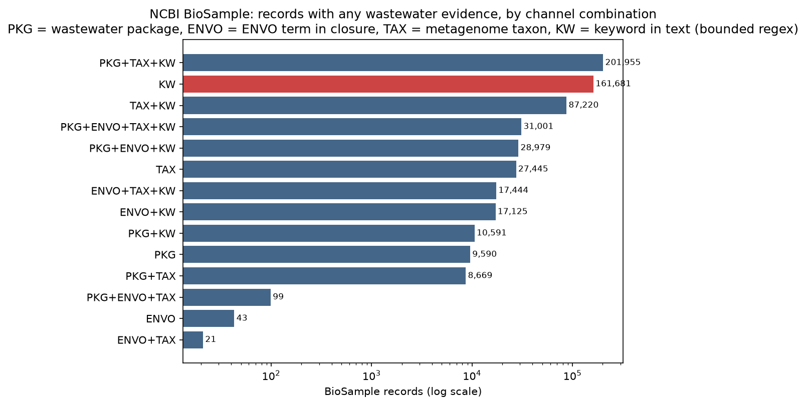
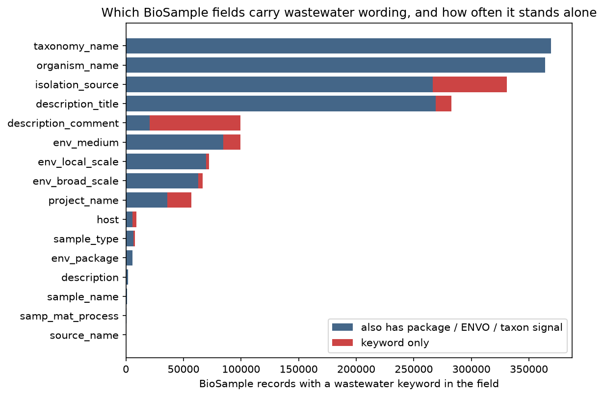
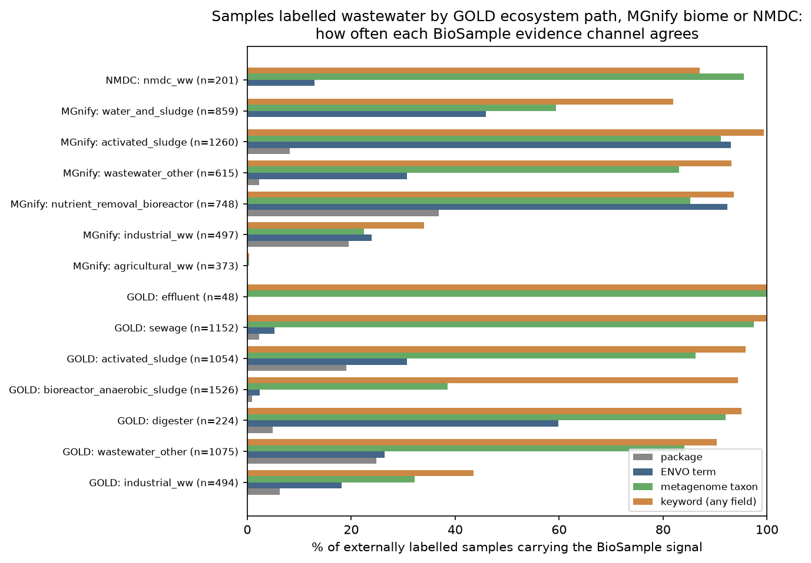
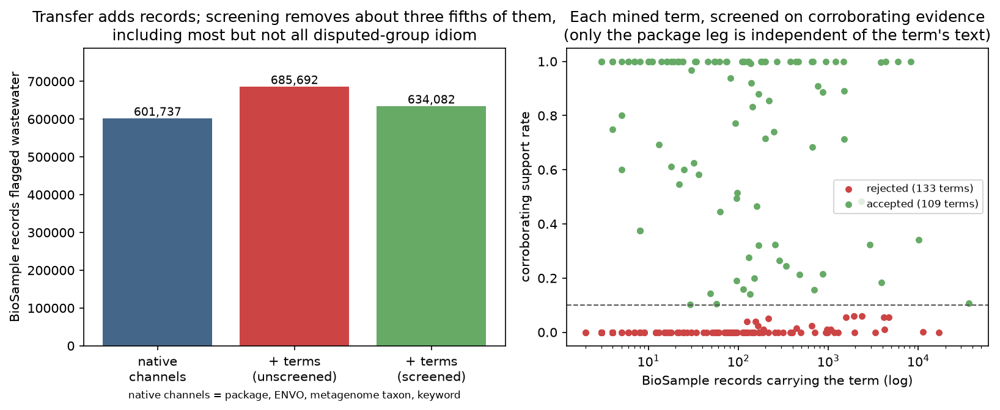

# Report: Wastewater Evidence Across Sample-Metadata Systems

Which attributes and values indicate that a sample is wastewater, or a particular
wastewater subtype, in each of four metadata systems; whether evidence learned in
a strong-signal system transfers to a weak-signal one; and how to check that the
transfer worked without hand-labelling thousands of records.

All findings are **exploratory**. No `RESEARCH_PLAN.md` was pre-registered, so
nothing here is confirmatory.

---

## Key Findings

### 1. Four evidence channels exist in BioSample and none subsumes another

Over all 51,711,888 BioSample records in the lakehouse snapshot, four channels
were flagged: the submitted BioSample **package**, an **ENVO** term from the
wastewater subclass closure attached to an environmental triad, the NCBI
**metagenome taxonomy** name, and a word-bounded **keyword** regex over 15 text
fields.

The channels are **not independent**, and nothing below should be read as if they
were. The ENVO triad annotation is parsed from the same `env_broad_scale`,
`env_local_scale` and `env_medium` strings that the keyword channel reads, so
agreement between those two is partly mechanical. Only the package channel, a
submitter's menu choice, is structurally separate from the free text.

The keyword channel is also defined slightly differently across runs: 15 fields
in the crosstab run, 14 in the cross-system join, 10 in the transfer runs. That
is why the native evidence set is 601,863 in one output and 601,737 in another.
The difference changes no conclusion, but the numbers are not interchangeable.

| Channel | Records | Share of all evidence-bearing records |
|---|---:|---:|
| Any channel | 601,863 | 100% |
| Keyword (15 fields) | 555,996 | 92.4% |
| Metagenome taxonomy name | 373,854 | 62.1% |
| Wastewater package | 290,884 | 48.3% |
| ENVO closure term | 94,712 | 15.7% |
| Keyword with no structured channel | 161,681 | 26.9% |
| Structured channel with no keyword | 45,867 | 7.6% |

Half the keyword hits sit outside any wastewater package, consistent in direction
with the author's prior figure of about 39%. The two numbers are not comparable
as stated: this run uses more text fields and a word-bounded pattern, and the
snapshot holds 51.7M records rather than 56M.

*(Run: `runs/20261017T012956Z-biosample-evidence`; basis: exploratory)*

### 2. The wastewater package is the most specific channel but is mostly one surveillance programme

Two thirds of all wastewater-package records are a single package.

| Package | Records |
|---|---:|
| `SARS-CoV-2.wwsurv.1.0` | 196,158 |
| `MIMARKS.survey.wastewater.6.0` | 31,807 |
| `MIMAG.wastewater.6.0` | 28,893 |
| `MIMS.me.wastewater.6.0` | 23,968 |
| `MIMARKS.specimen.wastewater.6.0` | 4,401 |
| `MIGS.ba.wastewater.6.0` | 3,318 |
| all remaining wastewater packages | 2,339 |

Treating the package as ground truth therefore trains on COVID-era sewage
surveillance. Those samples are overwhelmingly influent or raw sewage, so a
classifier anchored on the package will under-represent sludge, digester and
effluent matrices. Structurally the package is the channel least able to
pick up stray wording, since it is a submitter's menu choice rather than parsed
text, and the one with the narrowest coverage. No channel's precision was
measured.

*(Run: `runs/20261017T012956Z-biosample-evidence`, `package_counts.csv`; basis: exploratory)*

### 3. ENVO agrees most with the other channels and should be used as a closure, not a word list

Seeding from ENVO labels matching wastewater wording and walking `rdfs:subClassOf`
descendants in the entailed-edge table yields 24 terms. The closure is what makes
this work rather than label matching: it recovers `ENVO:2000002`, whose label is
the misspelled *"industrial wastewate treatment plant"* and which no spelling of a
keyword search would find.

The closure also over-reaches, and the code and the result disagree about it. The
seed filter deliberately excludes `ENVO:00002060` (oil sludge) and
`ENVO:00005796` (marine sludge), but both re-enter as subclasses of `sludge`. Oil
sludge is a petroleum residue and is not wastewater. The impact is at most 8
accessions, that being a sum of per-field counts rather than a distinct count,
immaterial to every count here, but a closure needs an exclusion list applied
after expansion, not only at the seeds.

The terms carrying most of this channel, by distinct accessions, are
`activated sludge` (ENVO:00002046) on `env_local_scale`, 20,442 records;
`waste water` (ENVO:00002001) on `env_medium`, 18,151; and
`wastewater treatment plant` (ENVO:00002043) on `env_local_scale`, 16,467.
"Agrees most" here means the highest overlap with the other three channels, not
a measured precision; no channel's precision was measured.

ENVO's weakness is reach: only 94,712 records carry any wastewater ENVO term,
because the curated triad annotation covers a small fraction of BioSample.

*(Run: `runs/20261017T012956Z-biosample-evidence`, `envo_terms.csv`, `envo_evidence_by_term.csv`; basis: exploratory)*

### 4. Which field carries the signal differs by system, so the transfer target differs too

In BioSample, `taxonomy_name` is almost never the sole evidence (12 of 369,048
hits stand alone), while `description_comment` usually is (78,836 of 99,551,
or 79%). The `taxonomy_name` row is close to mechanical and should not be read
as a measure of the field's informativeness: the taxon channel is itself a regex
over `taxonomy_name`, and 368,903 of those 369,048 hits fire it, so the two
channels are reading the same string. This is the same non-independence that
finding 1 notes for ENVO and keyword. Field availability matters as much as precision:

| Field | Records populated | BioProjects |
|---|---:|---:|
| `host` | 19,033,344 | 229,122 |
| `isolation_source` | 15,825,905 | 250,452 |
| `env_broad_scale` | 7,620,156 | 139,055 |
| `env_medium` | 7,447,939 | 136,662 |
| `env_local_scale` | 5,366,279 | 134,467 |
| `sample_type` | 3,286,750 | 59,564 |
| `env_package` | 364,222 | 7,667 |

Across systems the signal lives in different places entirely:

| System | Primary carrier | Secondary | Notes |
|---|---|---|---|
| NCBI BioSample | `taxonomy_name`, `isolation_source` | package, ENVO triad | Free text dominates by volume |
| MGnify | biome lineage; `environment (material)` | `environment (feature)` | `isolation source` populated on 28 of 4,352 samples |
| GOLD | 5-level ecosystem path | biosample name | Path is populated on essentially all biosamples |
| NMDC | ENVO `env_medium` term id | — | 13,640 of 27,352 biosamples have an empty ecosystem path |
| AllTheBacteria | `isolation_source` | `env_medium` | `context_label` has no wastewater category at all |
| ENA | `isolation_source`, `study_title` | `environment_material` | Checklist id is a weak discriminator |

The NMDC result inverts the expectation: NMDC inherits GOLD's ecosystem-path
vocabulary, but the path is empty on half its biosamples, and the ENVO triad is
what actually carries the wastewater signal there (201 biosamples by ENVO term
versus 17 by ecosystem path).

*(Runs: `runs/20261017T012956Z-biosample-evidence`, `runs/20261017T013332Z-external-vs-biosample`, `runs/20261017T012724Z-atb-ena-probe`, `runs/20261017T020823Z-review-checks`; basis: exploratory)*

### 5. The "digest" trap is large, and word boundaries shrink it without fixing it

Searching the substring `digest` in `env_broad_scale` returns 228,992 records, of
which 222,412 (97%) also match digestive-tract wording. **None of that digestive
subset is in a wastewater package**, against 5,831 of the full 228,992 substring
hits that are. In `description_comment`, 8,370 records match `undigested`.
Word-bounding removes a second class of error: unbounded `septic` matched 2,199
`taxonomy_name` values, which a bounded `\bseptic\b` reduces to zero, because the
hits were *Bordetella bronchiseptica*, *Elizabethkingia meningoseptica* and
relatives.

Bounding is a patch, not a fix. A bounded `\bsewers?\b` also stops matching
*sewerage*, trading false positives for false negatives. The durable fix is a
reviewed term list mapped to ontology identifiers, which is what finding 7
evaluates.

An early version of this analysis used unbounded patterns and silently counted
those bacterial names as wastewater hits; the corrected run supersedes it.

*(Run: `runs/20261017T012956Z-biosample-evidence`, `subtype_by_field.csv`; basis: exploratory)*

### 6. External labels and BioSample evidence disagree in both directions

Three external label sets were bridged to BioSample accessions: GOLD wastewater
ecosystem paths via sequencing projects (5,998 GOLD biosamples in wastewater
groups, 5,391 of them carrying an NCBI accession, 5,584 accessions), the 4,352
MGnify wastewater-biome samples, and 201 NMDC biosamples. All but one of the
10,137 label rows resolved to a BioSample record.

| Source | Labelled | Found | % package | % ENVO | % taxon | % keyword | % any signal |
|---|---:|---:|---:|---:|---:|---:|---:|
| GOLD | 5,584 | 5,583 | 9.9 | 16.7 | 70.7 | 90.6 | 93.1 |
| MGnify | 4,352 | 4,352 | 11.2 | 59.0 | 67.1 | 78.1 | 83.2 |
| NMDC | 201 | 201 | 0.0 | 12.9 | 95.5 | 87.1 | 100.0 |

1,117 external label rows, covering 1,110 distinct accessions, carry no
wastewater evidence of any kind in BioSample. That reproduces the author's MGnify observation (729 here against the
author's ~850). The gap between the two counts was not measured; the wider field
set used here is a possible reason, not a demonstrated one.

The disagreement is not one-directional, and the interesting half runs the other
way. MGnify's `root:Engineered:Wastewater:Industrial wastewater:Agricultural
wastewater` biome holds 373 samples of which **0.3%** show any wastewater
evidence in BioSample; their taxonomy is *Anas platyrhynchos* (mallard duck),
their `env_medium` is "water" or "cecal contents", their `env_broad_scale`
includes "water trough" (150 samples), "water line" (117) and "duck cecum" (70),
and their `env_local_scale` includes "barn" (198) and "aviary" (140). This
report's `industrial_ww` **group**, which spans five MGnify lineages, is 38.6%
`riverine metagenome` with `env_medium` "stream water"; all 192 of those
riverine records sit in the `Industrial wastewater` lineage itself, which is
therefore 62.7% riverine.

Two caveats on how far that goes. First, this is **study-level, not pervasive**:
the 372 unsupported agricultural samples fall in 3 BioProjects with 338 in one,
and the 287 unsupported industrial samples fall in 5 with 144 in one. Two studies
account for most of it, out of 4,352 samples under wastewater biomes. Second,
**the report cannot adjudicate intent**. A study of farm water sources and caecal
contents could be an agricultural-runoff design, and a stream survey could be
sampling the receiving waters of an industrial discharge; both would be defensible
biome assignments. Nothing here observes the physical matrix. The defensible
statement is that *the BioSample metadata for those studies does not describe
wastewater*, which is all the transfer argument needs.

GOLD's `industrial_ww` group is only 52% supported, and the composition of its
235 unsupported records is more mundane than mine drainage: 146 are
`Industrial wastewater > Unclassified`, 35 mine water, 30 hospital wastewater,
15 poultry processing and 9 acid mine drainage. Mine-related material is 44 of
235, not the main story. (A separate set of 79 records with `env_broad_scale`
= "acid mine drainage" belongs to MGnify's `Industrial wastewater:Mine water`
lineage, not to GOLD. Nothing here establishes that the lineage's 79 samples are
acid mine drainage; the two counts coincide.)

**The disagreement set is where disagreements between systems surface, not only
where BioSample is thin.** Any transfer scheme that treats one system's label as
ground truth will import the other system's description of the same samples.

*(Runs: `runs/20261017T013332Z-external-vs-biosample`, `runs/20261017T020823Z-review-checks`; basis: exploratory)*

### 7. Beyond what a generic keyword regex already finds, mined vocabulary recovers essentially no further records across studies, and its largest apparent gain survives screening

Candidate terms were mined from the externally labelled samples: for each
`(field, value)` pair, enrichment was computed against that exact value's
background frequency across all 51.7M records, using `content_pairs_aggregated`
for harmonized attributes. Keeping terms seen on at least 3 labelled samples,
enriched at least 50-fold, and at least 70% pure for one subtype gives 242 terms.

Applied to all of BioSample, those 242 terms hit 148,289 records, **83,955 of
which carry no native channel at all**, apparently a 14% expansion of the
findable set. Inspecting what they find shows the apparent gain is mostly the
vocabulary of individual studies applied far beyond them. Classifying every one
of those records by the term that matched it, by where that term's labelled
carriers came from, and by whether the screen kept the term, gives three groups
rather than two:

| Class | Records | Screen |
|---|---:|---|
| 1. Idiom from the disputed MGnify groups | 35,288 | rejects almost all |
| 2. Other terms the screen rejects | 16,668 | rejects |
| 3. Terms the screen keeps | 31,789 | keeps |
| Matched by terms of more than one class | 210 | mixed |

Two things about those classes should be explicit. The partition is
**hierarchical**: class 1 is decided before the verdict split, so 8 of its 29
terms are in fact accepted by the screen and their 411 records still count under
class 1. That is why class 3 reads 31,789 while finding 8's "51,610 are dropped"
implies 32,345 survivors. Both are right: the screen keeps 32,345 of the 83,955,
of which 31,789 are matched only by class-3 terms and the remainder by accepted
class-1 terms or a mix.

"Disputed" was also applied **only to terms whose labelled carriers are mostly
MGnify**. 31 terms carry a disputed subtype but are GOLD-dominant, among them
`mine tailing pool`, `animal house` and `rice wash waste`, and they fall into
classes 2 and 3 instead. Since finding 6 reports GOLD's industrial group as only
52% supported, that group is in dispute too, and the narrower boundary is a
choice rather than a necessity. Nor is class 1 uniformly idiom: its 8 accepted
terms include `acid mine drainage`, `anaerobic reactor` and `small river`, which
are plausible wastewater vocabulary.

**Class 1** is led by 16,920 *Anas platyrhynchos*, 10,343 `riverine
metagenome`, `cecal contents` and `stream water`. (These counts are the
no-native subset; finding 8 quotes the same terms over all their carriers, so
`riverine metagenome` appears there as 11,376 rather than 10,343.) The error
here is demonstrable
at the target end without adjudicating MGnify's intent. Applying `taxonomy_name
= Anas platyrhynchos` to BioSample flags 16,920 records, of which **none**
carries a wastewater package or ENVO annotation. Whatever MGnify meant by filing
its 338 duck-study samples under an agricultural wastewater lineage, the other
16,582 duck records are not wastewater by any BioSample metadata. What is being
demonstrated is the cost of generalising one study's wording, not an error in
the source label.

**Class 2** is broad terms whose labelled carriers are not in dispute but which
over-reach anyway, led by 4,170 `biofilter metagenome`. That term is mined from
MGnify's `nutrient_removal_bioreactor` group, not from a disputed one, and the
screen rejects it at 0.97% corroborating support.

**Class 3 is the one that matters**, because the screen does not remove it. It
is led by 25,859 `bioreactor metagenome`, mined from GOLD's
`Bioreactor > Anaerobic > Sludge` path, which this report groups as
`bioreactor_anaerobic_sludge` and which the Recommended scheme below flags as
AD-like but not stated as wastewater. The screen accepts it at 10.6%
corroborating support and finding 8 calls it too broad. So 25,859 records of the
apparent gain follow from this project's own decision to include that GOLD
group, not from any source system, and screening leaves them in place. This
class is what a hand review of the term table would mostly be adjudicating.

Enrichment and purity cannot catch any of the three. A homogeneous source group
produces vocabulary that is both rare in BioSample at large and highly pure for
that group's label. Purity measures consistency within a cluster and says
nothing about whether the cluster's label travels beyond it.

Cross-source hold-out quantifies the ceiling. 589 accessions carry both a GOLD
and an MGnify label, so the naive hold-out leaks; excluding them gives the clean
figures below.

| Direction | Recovered, all | Recovered, overlap excluded | On samples with no native signal |
|---|---:|---:|---:|
| GOLD vocabulary → MGnify samples | 49.8% (n=4,352) | 50.0% (n=3,763) | 1.2% (n=722) |
| MGnify vocabulary → GOLD samples | 17.9% (n=5,583) | 14.4% (n=4,994) | 0.5% (n=381) |

The no-native-signal column is the one that matters, and it needs care in the
MGnify direction: 658 of those 722 samples are the agricultural and industrial
groups whose labels finding 6 could not adjudicate. If those groups are in fact
wastewater studies, recovering almost none of them is a failure; if they are not,
it is the desired behaviour. The MGnify-direction result is therefore ambiguous,
and only the GOLD direction (n=381) supports the headline. There the result is
stark — broken out by group, recovery is **0.0% on all
235 industrial, 74 other-wastewater, 57 anaerobic-bioreactor-sludge and 11
digester samples**. The entire non-zero remainder is 2 samples out of 3 in a
tiny activated-sludge group.

So the negative result survives, and in cleaner form than first stated.
Three qualifications bound what it means, and the conclusion is restated after
them.

**The no-native test is strict by construction.** A record counts as having no
native signal only if it carries no wastewater package, no wastewater ENVO
annotation, no wastewater metagenome taxon and no match to the generic keyword
regex across 14 text fields. Any mined term that is itself generic wastewater
wording, such as `sewage` or `activated sludge`, therefore *cannot* recover such
a record: the keyword channel would already have caught it. Only non-generic
study idiom can score here, and the Scope section says such idiom does not
travel between studies. The test is really asking whether one system's study
idiom matches another system's studies.

**The GOLD denominator is small and lopsided.** Its 381 records are 235
`industrial_ww` spread over 21 BioProjects (146 unclassified industrial, 35 mine
water, 30 hospital, 15 poultry, 9 acid mine drainage), 74 other-wastewater, 57
from the `bioreactor_anaerobic_sludge` group that the Recommended scheme itself
says is not stated as wastewater, 11 digester, 3 activated sludge and 1 sludge.
The MGnify vocabulary tested against them is 94 terms mined from a cohort that
is 29.0% activated sludge, 19.7% water-and-sludge and 17.2% nutrient-removal
bioreactor, those three being 65.9% of it. The defensible reading is that 94
MGnify terms do not match the idiom of about 30 mostly-industrial GOLD
studies.

**Residual study-level overlap.** The exclusion of the 589 doubly-labelled
accessions was **test-side only**: both single-source term tables were mined
from all of their own source's labelled accessions, duals included, so each dual
still contributes vocabulary to the other direction's training table. The
residual that applies is therefore every non-dual test accession sharing a
BioProject with *any* accession labelled by the other source: **251** on the
MGnify side and **246** on the GOLD side, from 840 and 835 less the 589 duals,
all of which have BioProject links.

Two earlier figures for this were both wrong. 840 and 835 counted the duals
themselves; 31 and 1 excluded duals from both sides, which measures a design
that was not run and would only be right if the term tables were re-mined from
source-exclusive cohorts. They were not. Any such leak can only *inflate*
recovery, so the 50.0% and 14.4% all-samples figures and the 1.2% and 0.5%
no-native figures are upper bounds, and the negative conclusion is conservative
with respect to it.

**Restated within those bounds.** A term table mined from about 9,400 externally
labelled records reaches roughly the records a generic keyword regex over the
same ten fields already reaches, and the residual that only study idiom could
reach is essentially zero in this test: 2 of 381 GOLD records, with the MGnify
figure of 9 of 722 carrying the ambiguity noted above, since most of that
denominator is material finding 6 shows BioSample does not describe as
wastewater. Both are upper bounds. What is refuted is the transfer of study
idiom between systems, not the transfer of vocabulary in general, and the
evidence is 94 MGnify terms tested against about 30 mostly-industrial GOLD
studies. The useful positive half is in the
all-samples columns: the mined table does recover half the MGnify cohort and a
seventh of the GOLD cohort, which is to say the records that already had a
native signal.

*(Runs: `runs/20261017T014030Z-transfer-validate`, `runs/20261017T020823Z-review-checks`, `runs/20261023T150640Z-v24-checks`; basis: exploratory)*

### 8. Support screening removes most of the over-generalised idiom, though its independence is partial

Each mined term was screened on what this report calls **corroborating
support**: the rate at which BioSample records carrying the term also show a
wastewater package, a wastewater ENVO triad annotation, or membership in a
BioProject that contains package-flagged samples. Terms from `taxonomy_name`
were screened on package and ENVO only. Requiring 10% corroborating support
accepts 109 terms and rejects 133.

The name is deliberately weaker than "independent support", because the three
legs are not equally independent of the term being screened.
**Only the package leg is genuinely independent of the term's own text.** The
ENVO annotation is parsed from the `env_*` strings, so for a term mined from one
of those fields it partly asks whether the term's own wording maps to a
wastewater ENVO class. BioProject co-membership is independent of the text but
not of study structure: a term characteristic of a large study that used the
wastewater package for some samples inherits support from it.

The outputs show how much weight each leg actually carries. Of the 109 accepted
terms, 81 clear the bar on package support, 26 are accepted on ENVO support alone
(21 of them from `env_*` fields, 2,588 records), and 2 on BioProject
co-membership alone (592 records). Re-screening `env_*` terms on package and
project only drops 21 accepts covering 2,588 records. The screen therefore works
mostly on its sound leg, but the circular leg is load-bearing for about a fifth
of the accepted vocabulary, and the report does not claim otherwise.

The screen rejects most of the over-generalised study idiom: *Anas
platyrhynchos* (16,920 records, 0.000 support), `riverine metagenome` (11,376,
0.002), `cecal contents` (1,967, 0.000), `stream water` (1,276, 0.000),
`animal house` (978, 0.000). Of the 83,955 records the unscreened table added,
51,610 are dropped.

It does not catch everything, and one case shows the failure mode exactly.
`env_local_scale = anaerobic` is mined from MGnify's nutrient-removal group,
where it is apt, and the screen accepts it at 32.4% corroborating support. In
BioSample at large it matches 2,886 records, and it is the term that pulls in
**all 1,283 *Gallus gallus* records** that survive screening: chicken-gut
samples whose local environment is described as anaerobic. The term has genuine
support in its home domain and over-matches badly outside it, which is precisely
what corroborating support cannot detect. The broad term from the
`bioreactor_anaerobic_sludge` group survives for the same reason, as finding 7
notes.

It is not an automatic classifier. It over-rejects unambiguous vocabulary that
submitters simply do not accompany with structured annotation: `isolation_source
= sewage` (2,367 records, 6.0% support) and `isolation_source = anaerobic
digester` (4,707 records, 5.6%) are both rejected. It also accepts terms that are
too broad, such as `taxonomy_name = bioreactor metagenome` at 10.6% support, just
over threshold, and `env_local_scale = water` at 18.3%.

The practical reading is that the screen turns an unbounded record-labelling
problem into a **bounded review of 242 ranked terms**. That is the answer to
"without hand-labelling thousands of records": you do not label records, you
review a term table, and the screen tells you which end of it to start at.

*(Runs: `runs/20261017T014428Z-term-screen`, `runs/20261017T020823Z-review-checks`, `runs/20261023T150640Z-v24-checks`; basis: exploratory)*

### 9. Three label-free diagnostics rank channels, with stated limits

**BioProject coherence.** Samples in a BioProject are usually one study of one
matrix, so a trustworthy flag should fire on nearly all or nearly none of a
project. Binning each project by its flagged fraction, and counting only projects
with at least 5 samples:

| Channel | Projects ≥80% flagged | Projects <20% flagged | Flagged samples in ≥80% projects |
|---|---:|---:|---:|
| Wastewater package | 1,249 | 49 | 98.2% |
| Keyword | 4,720 | 576 | 94.2% |
| Transferred terms (unscreened) | 2,027 | 356 | 85.4% |

The last column is the share of each channel's **flagged** samples that sit in
projects where the channel fires on at least 80% of samples. Its base is that
channel's total flagged samples among projects where it fired at all: 248,139
for package, 428,483 for keyword, 111,314 for the term table.

The keyword and term channels scatter more than the package channel. In the
576 keyword-firing projects where the channel fires on under a fifth of samples,
7,106 samples are flagged out of 303,334 present, and that is where free-text
false positives concentrate. This diagnostic needs no labels at all.

It ranks channels; it does not score them. The package comparison is close to
tautological, since the package is chosen once per submission, so its coherence
measures the granularity of the assertion rather than its correctness. And the
confound bites inside the reference itself, where 49 package-firing projects
under 20% flagged hold 51,532 samples, 1,818 of them flagged. A within-project
permutation null, shuffling flags while holding project sizes fixed, would put
all three channels on one basis and is the obvious next step.

**Trap sets.** Deliberately constructed near-miss cohorts, counted directly:

| Trap | Records matching | Flagged by terms | Flagged by keyword |
|---|---:|---:|---:|
| Digestive tract wording | 371,717 | 280 | 154 |
| `undigested` feedstock | 418 | 16 | 12 |
| Dialysis / peritoneal effluent | 132 | 0 | 132 |
| Septicaemia organisms | 1,849 | 0 | 1 |
| `river discharge` wording | 3 | 0 | 2 |

The dialysis row is the useful one: the keyword channel flags all 132 and the
term table flags none, so the two channels fail differently and a trap set
distinguishes them.

**Cross-source hold-out**, from finding 7, is the most demanding of the three and
the one that revealed the transfer ceiling.

*(Runs: `runs/20261017T014030Z-transfer-validate`, `runs/20261017T014428Z-term-screen`; basis: exploratory)*

### 10. Subtype assignment is the weakest link and should be multi-label

Applying subtype regexes across six fields, only **30.8%** of the 685,692 records
flagged by any channel including the transferred terms receive a subtype:
activated sludge 67,511, digester 50,339, generic sludge 60,300, influent 16,434,
effluent 10,951 and sewer 5,510, totalling 211,045 typed against 474,647
unspecified.

Worse, the subtypes are not mutually exclusive and the implementation resolves
overlap by first match in an arbitrary order. Real descriptions such as
"anaerobic digester sludge" and "influent of an activated sludge plant" belong to
two classes each. Subtype should be modelled as independent binary labels over
matrix (sludge, water, biofilm), process stage (influent, effluent) and unit
operation (activated sludge, digester, sewer), not as one categorical field.

*(Run: `runs/20261017T014030Z-transfer-validate`, `subtype_assignment.csv`; basis: exploratory)*

---

## Recommended scheme

**Per-system indicators, ranked.**

| System | Use first | Then | Avoid as sole evidence |
|---|---|---|---|
| BioSample | wastewater package; ENVO closure on the triad | `taxonomy_name` exact match against the 8 wastewater metagenome taxa; reviewed term list on `isolation_source` / `env_medium` / `env_local_scale` | `description_comment`; any unbounded substring |
| MGnify | biome lineage under `root:Engineered:Wastewater` | `environment (material)`, `environment (feature)` | the lineage alone for `Industrial wastewater` and `Agricultural wastewater`, each dominated by one study whose BioSample metadata describes duck housing water or stream water |
| GOLD | ecosystem category/type in {Wastewater, WWTP, Sewage treatment plant} | subtype and specific-ecosystem levels | `Bioreactor > Anaerobic > Sludge`, which is AD-like but not stated as wastewater |
| NMDC | ENVO `env_medium` term id | `env_broad_scale` / `env_local_scale` term ids | ecosystem path, empty on half the biosamples |
| AllTheBacteria / ENA | `isolation_source` | `environment_material` (2.2% hit density, the highest of any ENA field) | `context_label`, `checklist` |

**Transfer procedure.**

1. Collect external labels and bridge them to BioSample accessions. GOLD bridges
   through sequencing projects (`ncbi_biosample_accession`); MGnify carries
   `biosample` directly; NMDC carries `insdc_biosample_identifiers`.
2. Mine `(field, value)` candidates from the labelled set, scored by enrichment
   against the exact-value background in `content_pairs_aggregated`.
3. **Screen every candidate on corroborating support** (package, ENVO, BioProject
   co-membership), remembering that only the package leg is independent of the
   term's own text. Do not skip this step. Unscreened, a single disputed source
   group is amplified roughly 50-fold: the 338 duck samples in one BioProject
   (`PRJEB11269`) yield a taxonomy term that matches 16,920 BioSample records,
   a ratio of 50.1 to 1.
4. Review the ranked term table by hand. 242 terms is a few hours of work, versus
   tens of thousands of records.
5. Map accepted terms to ENVO identifiers so the output is an annotation rather
   than another regex, and emit multi-label subtypes.

**Validation.** Run all four checks: cross-source hold-out, BioProject coherence
against the package reference curve, trap sets, and a small stratified audit. The
audit still matters, but it should be drawn from the *disagreement cells* of the
channel crosstab, which is roughly 200-400 records rather than thousands, and it
measures precision exactly where precision is uncertain.

---

## Scope of the Claim

This is a result about **51,711,888 NCBI BioSample records in the BERDL snapshot**,
the **245,123 biosamples in GOLD's public Excel export**, the **4,352 samples
retrieved under MGnify's wastewater biome lineages**, and the **27,352 biosamples in NMDC's
`biosample_set`**. The externally labelled cohort used for transfer is 9,390
distinct accessions, about 0.018% of BioSample.

That cohort is **study-clustered, not a random sample**, which is the practical
consequence: the mined term table is the vocabulary of a few dozen studies. One
BioProject supplies 338 of the 372 unsupported agricultural records and another
supplies 144 of 287 unsupported industrial records. The GOLD side is
JGI-sequenced projects and is clustered too, though less tightly: the 235
unsupported GOLD industrial records span 21 BioProjects with 86 in the largest,
and finding 7's negative result now rests on that 381-record cohort. Terms such
as "water trough" or "lotic environments" are
study idiom, not community vocabulary, and would not generalise to a different
decade of submissions.

It is not a result about wastewater samples in general, nor about the full
contents of ENA or SRA. Every external label used here is itself a curation
artifact, and finding 6 shows that for two MGnify biomes the BioSample metadata
of the dominant study does not describe wastewater, without being able to say
whether the biome assignment is wrong. Statements about "wastewater samples" below the
level of "records whose metadata asserts wastewater" are not supported: nothing
here observes the physical matrix. Subtype counts in finding 10 are lower bounds
produced by a first-match regex and should not be read as prevalence.

---

## Limitations

- **No ground truth anywhere.** Every channel is an assertion by a submitter or a
  curator. Agreement between channels is evidence of consistency, not correctness,
  and the channels are not fully independent: the ENVO triad annotation is derived
  from the same free text the keyword channel reads, so their agreement is inflated.
  This also makes the ENVO leg of the term screen circular for `env_*` terms
  (finding 8).
- **The term table's lift scores have two known distortions.** Four of 758
  candidate values were absent from the background frequency table and were
  assigned the maximum possible lift by the fallback, promoting them to the top
  of the table. And the lift numerator counts label rows while the denominator
  counts distinct accessions, so values on the 747 doubly-labelled accessions are
  inflated. Recomputing with an accession-based numerator drops **3 of the 242
  terms**, all three because they rest on only 2 distinct accessions counted as 4
  label rows and so fail the minimum-count filter, not the lift threshold. No term
  is gained. On the background fallback the two runs disagree: the original
  transfer run logged 4 of 758 candidate values unresolved and gave them the
  maximum lift, while the recomputation six days later resolved every value. The
  cause was not identified, and no term in the final table depends on the
  fallback under the later reading.
- **The hold-out's exclusion of doubly-labelled accessions was test-side only.**
  The term tables were mined from all of each source's labelled accessions, so
  251 MGnify and 246 GOLD non-dual test accessions still share a BioProject with
  a training accession from the other source. Re-mining from source-exclusive
  cohorts would remove this; it was not done.
- **The keyword channel is not one definition.** It covers 15 fields in the
  crosstab run, 14 in the cross-system join and 10 in the transfer runs, which is
  why the native set is 601,863 in one output and 601,737 in another.
- **The BioProject coherence diagnostic is confounded.** A large study with a
  handful of legitimate wastewater controls looks identical to a study where the
  rule misfires on a handful of samples. It ranks channels; it does not score them.
- **`biosamples_flattened` carries 180 columns**, but `biosamples_attributes`
  holds 756M attribute rows under 810 harmonized names. Signal in the long tail of
  attributes was not examined.
- **The MGnify cohort is what the API returned, not what it advertised.** Two
  lineages came back short: `Water and sludge` gave 859 samples against 958
  advertised, and one nutrient-removal lineage gave 8 against 17. So "4,352
  samples" means all that were retrievable, about 108 fewer than listed, and the
  shortfall was not investigated.
- **The GOLD bridge is partial.** 5,391 of 5,998 GOLD wastewater biosamples reach
  an NCBI accession; the remaining 607 are invisible to any BioSample-side check.
- **NMDC's contribution is 201 samples**, too small to support per-subtype
  statements, and none of them is in a wastewater package.
- **The 10% corroborating-support threshold is arbitrary** and was not tuned against
  any held-out criterion. Findings 8's accept/reject counts move with it.
- **Subtype regexes were not validated** beyond the trap sets; precision per
  subtype is unmeasured.

## What Would Have Changed Our Mind

- The transfer hypothesis predicted that vocabulary learned in a strong-signal
  system would recover weak-signal samples. Tested cleanly, with doubly-labelled
  accessions removed, held-out recovery on samples with no native BioSample
  signal was **1.2% and 0.5%**, and **0.0% in every GOLD group of more than three
  samples**. Both rates are upper bounds, because residual study-level overlap
  can only inflate them, and only the GOLD direction carries the conclusion: most
  of the MGnify denominator is material finding 6 shows BioSample does not
  describe as wastewater. That refutes the simple version of the transfer idea
  for this cohort. It is a strict test by construction, since generic wastewater wording
  cannot recover a record that has no keyword match, so what it refutes is the
  transfer of study idiom, not of vocabulary in general.
- Looked for and not found: a structured attribute that cleanly separates
  wastewater subtypes in any system. `env_package` is populated on only 364,222
  of 51.7M records and carries wastewater wording on 5,706 of them, ENA's
  `checklist` puts most keyword hits in a NULL or generic-default bucket, and
  AllTheBacteria's `context_label` has no wastewater category, scattering its
  10,858 wastewater isolates into `environmental:water` and `human:clinical`.
- Arguing against the headline: the single largest "new" group the transfer found
  was 16,920 duck records. If the error screen had not been run, this report
  would have claimed a 14% expansion of the wastewater set that was mostly
  waterfowl.

---

## Data

### Sources

| Collection | Tables used | Purpose |
|---|---|---|
| `nmdc` | `ncbi_biosamples.biosamples_flattened`, `.env_triads_flattened`, `.ncbi_packages_flattened`, `.content_pairs_aggregated`, `.harmonized_name_usage_stats`, `.sra_biosamples_bioprojects` | NCBI BioSample records, parsed environmental triads with ENVO ids, package registry, exact-value background frequencies, BioProject links |
| `nmdc` | `metadata.biosample_set` | NMDC biosamples with ecosystem paths, ENVO triad terms, INSDC and GOLD identifiers |
| `kbase` | `ontology_source.statements`, `ontology_source.entailed_edge` | ENVO labels and the subclass closure |
| `refdata` | `all_the_bacteria.biosample_environment`, `all_the_bacteria.ena_metadata` | Isolate-level environment fields and ENA checklist metadata |
| GOLD (external) | public Excel export, `download?mode=site_excel` | 5-level ecosystem paths and the sequencing-project bridge to NCBI accessions |
| MGnify (external) | REST API v1, `/biomes` and `/biomes/{lineage}/samples` | Biome lineages and per-sample metadata |

### Generated data

| File | Rows | Description |
|---|---:|---|
| `runs/20261017T011423Z-gold-parse/out/gold_biosample.parquet` | 245,123 | GOLD biosamples with ecosystem paths |
| `runs/20261017T011423Z-gold-parse/out/gold_sequencing_project.parquet` | 637,103 | GOLD → NCBI accession bridge |
| `runs/20261017T011424Z-mgnify-fetch/out/mgnify_ww_samples.parquet` | 4,352 | MGnify wastewater-biome samples actually retrieved; the API advertised about 108 more (859 of 958 for `Water and sludge`, 8 of 17 for one nutrient-removal lineage) |
| `runs/20261017T013332Z-external-vs-biosample/out/labelled_samples.parquet` | 10,137 | External labels joined to BioSample channel flags |
| `runs/20261017T014030Z-transfer-validate/out/term_table.csv` | 242 | Mined transfer vocabulary |
| `runs/20261017T014428Z-term-screen/out/term_screen.csv` | 242 | Each term with corroborating-support rates and verdict |

## Supporting Evidence

### Runs

| Run | Purpose |
|---|---|
| `runs/20261017T011209Z-schemas` | Schemas and row counts of 37 candidate tables |
| `runs/20261017T011423Z-gold-parse` | Stream GOLD's 239 MB Excel export to parquet |
| `runs/20261017T011424Z-mgnify-fetch` | Page the MGnify API for biomes and wastewater samples |
| `runs/20261017T012956Z-biosample-evidence` | Four-channel crosstab, per-field keyword counts, subtype and trap counts |
| `runs/20261017T012724Z-atb-ena-probe` | AllTheBacteria and ENA field and checklist probe |
| `runs/20261017T013332Z-external-vs-biosample` | Bridge external labels to BioSample; per-source and per-subtype agreement; learned vocabulary |
| `runs/20261017T014030Z-transfer-validate` | Mine the term table, hold-out transfer, BioProject coherence, trap set |
| `runs/20261017T014428Z-term-screen` | Screen terms on corroborating support; measure what screening removes |
| `runs/20261023T155021Z-figures` | Four summary figures |
| `runs/20261023T142719Z-v22-checks` | Re-derivation for the v2.2 edits: which field carries each disputed value, the MGnify industrial composition, finding 8's per-term support rates, the amplification ratio |
| `runs/20261023T145016Z-v23-checks` | Computation for the v2.3 edits: BioProject coherence with flagged-sample counts, study-level overlap left by the accession-level hold-out exclusion, and whether the lift distortions change any accepted term |
| `runs/20261023T150640Z-v24-checks` | Computation for the v2.4 and v2.5 edits: the overlap figures, which accepted term carries the surviving chicken records, the MGnify cohort composition, and the three-class breakdown of the unscreened gain |
| `runs/20261017T020823Z-review-checks` | Verification of the independent review's corrections: subtype denominator, GOLD industrial composition, hold-out overlap, screen support basis, field population counts, study clustering |

Two superseded runs are retained for the record: `runs/20261017T011707Z-biosample-evidence`
and `runs/20261017T012405Z-atb-ena-probe` used unbounded regexes whose counts are
invalid (see `memories/pitfalls.md`).

### Figures

| Figure | Shows |
|---|---|
| `figures/fig_biosample_evidence_combos.png` | Records by combination of the four evidence channels |
| `figures/fig_keyword_by_field.png` | Keyword hits per field, split by whether a structured channel agrees |
| `figures/fig_external_signal.png` | Per external source and subtype, how often each BioSample channel agrees |
| `figures/fig_transfer_screen.png` | What transfer adds, what screening removes, and each term's corroborating support |

## Discoveries

- In NCBI BioSample, the wastewater package is 67% a single COVID-era sewage
  surveillance package (`SARS-CoV-2.wwsurv.1.0`), so using the package as ground
  truth silently restricts training data to influent and raw sewage.
- Mining vocabulary from an externally labelled sample set and filtering on
  enrichment plus subtype purity does **not** stop one study's idiom being applied
  far beyond it: a homogeneous source group produces terms that are rare and pure
  and still wrong outside that group, whether or not the group's own label is.
  Corroborating-support screening catches most of this but not all: a term with
  genuine support in its home domain can over-match badly elsewhere, as
  `env_local_scale = anaerobic` does in reaching 1,283 chicken-gut records. Screening candidate terms on corroborating support catches it, but the legs of
  that measure are not equally independent: only the submitter-chosen package is
  independent of the term's text. Ontology
  annotations parsed from the same strings are circular for terms mined from
  those fields, and BioProject co-membership is independent of text but not of
  study structure.
- Within-BioProject coherence is a usable label-free **ranking** diagnostic for
  any sample-level flag over NCBI data: 98.2% of the submitter-asserted package
  channel's flagged samples sit in projects where it fires on at least 80% of
  samples, against 94.2% for a keyword channel and 85.4% for mined terms, each
  taken over that channel's own flagged samples in projects where it fired. It is a comparison, not a score, because the package reference
  is near-tautological and large mixed studies confound all three curves.
- `\b` inside a Spark SQL `RLIKE` string literal is parsed as a backspace, not a
  word boundary, so word-bounded regexes silently match almost nothing.

## Performance Notes

- `kbase.ontology_source.entailed_edge` makes ENVO subclass closure a single
  cheap join; seeding by label and expanding by closure took about 5 seconds
  against the 42.9M-row `statements` table.
- `nmdc.ncbi_biosamples.content_pairs_aggregated` (66.4M rows of
  `harmonized_name` × `content` × `biosample_count`) is the right table for
  exact-value background frequencies. It avoids a full scan of the 51.7M-row
  `biosamples_flattened` per candidate term.
- The Spark Connect ingress returns HTTP 413 for a single large local relation.
  Creating a DataFrame of ~10k rows must be chunked at about 1,000 rows per
  request into separate temp views, then unioned server-side.

## Revision History

- **v2** (2026-10-17): corrections after the independent review in `REVIEW_1.md`,
  each verified against the run outputs in `runs/20261017T020823Z-review-checks`.
  Finding 10's typed-subtype fraction was computed against the wrong denominator
  and is corrected from 21% to 30.8%. Finding 6's attribution of GOLD's weak
  industrial support to acid mine drainage was wrong and is replaced with the
  actual composition; the MGnify mislabelling claim is narrowed to study level
  with alternative readings stated; "aviary" is corrected from `env_broad_scale`
  to `env_local_scale`. Finding 7 now reports the 589-accession hold-out overlap,
  the overlap-excluded numbers and the per-group breakdown. Finding 8 no longer
  claims full independence for the screen and quantifies which leg carries each
  accept. Findings 1, 7, 8 and 9 were retitled so the headings cannot be quoted
  against the body. Field population counts, previously untraced, now come from a
  recorded run. No figure changed.
- **v2.1** (2026-10-22): Finding 7 no longer calls the MGnify-direction result the
  desired behaviour, because finding 6 cannot say whether those groups are
  wastewater; it is reported as ambiguous, and only the GOLD direction supports the
  headline. Edited by hand by Mark Miller, outside a Workbench session. No figure
  changed.
- **v2.2** (2026-10-23): wording and traceability corrections requested after the
  second review, verified in `runs/20261023T142719Z-v22-checks`. The screen's
  measure is renamed from "independent support" to **corroborating support**
  throughout, including the figure, data, run and discovery entries, because the
  report's own finding 8 and Limitations say the ENVO leg is circular for `env_*`
  terms; the stronger name contradicted them. Three sentences that still treated
  the disputed external groups as settled errors (the transfer procedure, Scope,
  and Future Direction 4) now match finding 6's position that the two systems
  describe those samples differently and this analysis cannot say which is right.
  Finding 6's duck-sample field attribution is corrected: "water trough" (150),
  "water line" (117) and "duck cecum" (70) are `env_broad_scale` values, while
  "barn" (198) and "aviary" (140) are `env_local_scale`; the previous text put all
  of them in `env_local_scale`. The 729-versus-850 gap is no longer attributed to
  the wider field set, which was never measured. The previously undefined
  "50-to-1 amplification" is now derived where it is used (338 source samples in
  BioProject `PRJEB11269` to 16,920 matched BioSample records, 50.1 to 1).
  **Rechecked and unchanged:** the 38% `riverine metagenome` share for MGnify's
  `industrial_ww` group (192 of 497 found samples, 38.6%; the no-signal subset is
  higher at 50.2%), and all nine per-term support rates quoted in finding 8, every
  one of which matches `term_screen.csv`. Figures were regenerated for the renamed axis
  label and for a figure title that called the disputed groups mislabelled; no
  plotted value changed. The analysis script
  `src/04b_term_screen.py` keeps its original internal variable names, since
  editing it would invalidate the run record that finding 8 cites.
- **v2.3** (2026-10-23): suggestions 1 to 10 of `REVIEW_2.md`, computed where they
  needed computing in `runs/20261023T145016Z-v23-checks`. **Finding 9 was wrong
  about its own output**: the coherence query sums project sizes, so the figure
  previously called "303,334 keyword-flagged samples" is the number of samples in
  those projects, of which 7,106 are flagged. The table's last column now reports
  the share of each channel's *flagged* samples in high-coherence projects (98.2%
  package, 94.2% keyword, 85.4% terms) with its base stated, and discovery bullet
  3 carries the same base. **Finding 7's heading and body now respect finding 6's
  hedge**: the propagation argument is made on target-side evidence (the duck term
  matches 16,920 BioSample records, none with package or ENVO support) rather than
  on a claim about MGnify's intent, and finding 8 and discovery bullet 2 follow.
  The `bioreactor metagenome` example is separated out, because it comes from a
  GOLD group this project chose to include and the screen accepts it, so roughly
  30,000 of the apparent gain is this project's own inclusion decision rather than
  any source error. Finding 6 now says "group" not "biome" for `industrial_ww` and
  gives the lineage figure (62.7%) beside the group figure (38.6%). Finding 7
  gains three qualifications: the no-native test excludes generic wastewater
  wording by construction, the 381-record GOLD denominator is given in full, and
  the accession-level overlap exclusion leaves 840 and 835 accessions sharing a
  BioProject across sources. Scope gains the GOLD-side clustering. Findings 2 and
  3 are retitled so they no longer assert a precision nothing measured. The
  1,117 figure is relabelled as label rows over 1,110 accessions. **The
  Limitations claim that the lift distortions change no accepted term was
  asserted, not computed, and is false**: an accession-based numerator drops 3 of
  242 terms, each resting on 2 accessions counted as 4 label rows. `README.md`
  gains the three verification scripts and loses its stale "(TBD)" links.
  Finding 8's heading drops "propagated error" for the same reason.
  Suggestion 11 was skipped on request. No figure changed.
- **v2.4** (2026-10-23): suggestions 1 to 7 of `REVIEW_3.md`, computed in
  `runs/20261023T150640Z-v24-checks`. **Two attributions introduced by v2.3 were
  wrong.** `biofilter metagenome` was placed in the bucket of broad terms the
  screen keeps; it is mined from MGnify's `nutrient_removal_bioreactor` group,
  not GOLD's bioreactor group, and the screen rejects it at 0.97% support. And
  1,283 *Gallus gallus* records were listed as idiom the screen rejects when they
  in fact survive screening, which inverted their meaning. Finding 7's two-way
  split is replaced by a three-class breakdown of all 83,955 records, counted
  rather than illustrated, and the figure attributed to this project's own
  inclusion decision drops from "about 30,000" to 25,859. Tracking the chicken
  records to their carrier identified the screen's failure mode concretely:
  `env_local_scale = anaerobic`, mined from a nutrient-removal cohort where it is
  apt and accepted at 32.4% support, matches 2,886 BioSample records including
  every one of those 1,283. Finding 8 and discovery bullet 2 now carry that
  counterexample instead of claiming the screen rejects this material cleanly.
  **The study-overlap figures were also wrong**: the query never excluded the 589
  doubly-labelled accessions, each of which shares a BioProject with itself, so
  840 and 835 were upper bounds. The true residual is 31 MGnify and 1 GOLD
  accession. The direction of that leak is corrected too, from "does not affect
  the no-native figures" to "can only inflate them", making the headline figures
  upper bounds. Finding 7 is retitled in the narrower form the body supports and
  gains a restatement after its three qualifications. Finding 6's bolded closing
  sentence and finding 2's body no longer assert errors or precision that were not
  established. The MGnify cohort composition replaces "mostly" with its shares.
  The lift bullet now records once that the two runs disagree on how many
  background values were unresolved, 4 against 0, with the cause unidentified.
  Suggestion 8 was skipped on request. No figure changed.
- **v2.5** (2026-10-23): suggestions 1 to 10 of `REVIEW_4.md`, the first review by
  a different model. **The v2.4 overlap residual was also wrong.** 31 and 1
  measured a design that was not run: the exclusion of the 589 doubly-labelled
  accessions was test-side only, and both term tables were mined from all of
  their own source's accessions, duals included. The residual that applies is
  251 and 246, by subtracting the 589 from 840 and 835. Both earlier figures are
  named as wrong rather than quietly replaced, and the Limitations record the
  test-side-only design. **A figure did change**, contradicting v2.4's closing
  line: `fig_transfer_screen.png` was still titled "screening removes the ones
  inherited from disputed source groups", which is what v2.4 retracted, and is
  retitled to say screening removes about three fifths including most but not
  all such idiom. All four figures are regenerated with tight bounding boxes, so
  three previously clipped titles now render. Finding 7's heading now matches its
  body by naming the surviving gain rather than the unscreened state; its class
  table gains the hierarchical-partition and class-boundary caveats, including
  that 8 of the 29 class-1 terms are accepted and that 31 GOLD-dominant terms
  carry a disputed subtype but fall outside class 1; and class 3 is reconciled
  with finding 8's 51,610. The restatement's keyword baseline is corrected from
  14 fields to the ten actually used, and both it and the What Would Have Changed
  Our Mind bullet now carry the MGnify-direction ambiguity and the upper-bound
  caveat. Finding 4 gains the caveat that its `taxonomy_name` row is mechanical,
  since the taxon channel reads that same string. Finding 6's mine-water
  parenthetical no longer relabels a lineage as acid mine drainage. The MGnify
  cohort is recorded as what the API returned, about 108 short of what it
  advertised. Finding 3's 8 accessions is marked an upper bound, finding 9's trap
  table regains its dropped `river discharge` row, and finding 7 notes that it
  and finding 8 quote the same terms on different bases. README housekeeping
  done.

## Future Directions

1. Review the 242-term table by hand, map accepted terms to ENVO identifiers, and
   re-measure coverage. This is the single highest-value next step and is bounded.
2. Re-run subtype assignment as independent binary labels over matrix, process
   stage and unit operation, then measure per-subtype precision on a stratified
   audit of 200-400 records drawn from the crosstab's disagreement cells.
3. Mine the long tail of `biosamples_attributes` (810 harmonized names) for
   wastewater-specific measurements such as chemical oxygen demand, mixed liquor
   suspended solids and sludge retention time, which would discriminate subtypes
   on evidence independent of any environment description.
4. Feed the 1,110 externally labelled accessions with no BioSample signal back to
   MGnify and GOLD as curation candidates, separating the genuine BioSample gaps
   from the disputed groups of finding 6, where the two systems describe the
   samples differently and this analysis cannot say which is right.
5. Repeat the bridge in the other direction: start from BioSample wastewater
   packages and ask how many reach a GOLD or MGnify label, to estimate the
   coverage of each external system rather than its precision.
6. Put the BioProject coherence curves on a common basis with a within-project
   permutation null, shuffling flags while holding project sizes fixed, so the
   three channels are comparable without leaning on the near-tautological package
   reference. Add figures for the hold-out and coherence results, which are
   currently the two findings with no visual.
7. Re-screen the `env_*` terms on package and BioProject support only, dropping
   the circular ENVO leg, and report how coverage moves. The counterfactual here
   loses 21 accepted terms covering 2,588 records, but it has not been carried
   through to a full re-application.

## References

- Eloe-Fadrosh EA et al. (2022). "The National Microbiome Data Collaborative Data
  Portal: an integrated multi-omics microbiome data resource." *Nucleic Acids
  Research*. PMCID: PMC8958897.
- Blumberg KL et al. (2021). "Ontology-Enriched Specifications Enabling Findable,
  Accessible, Interoperable, and Reusable Marine Metagenomic Datasets in
  Cyberinfrastructure Systems." *Frontiers in Microbiology*. PMID: 34956127.
- Griffiths E et al. (2017). "Context Is Everything: Harmonization of Critical
  Food Microbiology Descriptors and Metadata for Improved Food Safety and
  Surveillance." *Frontiers in Microbiology*. PMID: 28694792.

See `references.md` for the searches run and related observatory projects.
